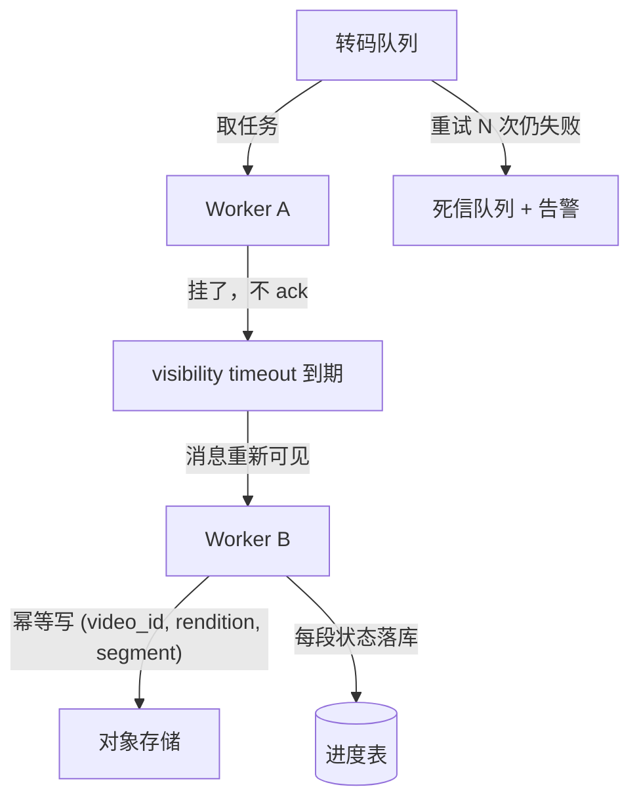

## Q
**转码 Worker 挂了怎么办**｜模拟面试补强 · 视频平台（YouTube）

面试官：「转码到一半，Worker 进程挂了，这个视频会怎样？」

## A
**一句话。** 任务在队列里有可见性超时，Worker 挂了消息会重新出现、被别的 Worker 接手；按 `(video_id, rendition, segment)` 幂等写，多次失败进死信队列。

**要点。**
- 谁发现它挂了？：Worker 不 ack，visibility timeout 到期后消息重新可见，交给其他 Worker。
- 重做会不会写坏？：输出 key 是 `(video_id, rendition, segment)`，重写同一对象，结果相同。
- 一直失败呢？：重试 N 次后进死信队列，告警并标记视频转码失败，人工或降级处理。
- 进度存哪？：每段的状态落库，重启后只重做没完成的段，不从头来。

**常见失分。**
- 答非所问：被问 Worker 挂了，两次都答成上传中断；先复述被问的故障，再答。
