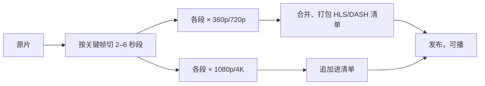

## Q
**转码 10 分钟太慢：切段并行**｜模拟面试补强 · 视频平台（YouTube）

面试官：「转码要 10–15 分钟，怎么做到上传后一分钟内能播？」

## A
**一句话。** 按关键帧把视频切成 2–6 秒的段，每段 × 每个档位并行转码，再拼清单；先出低档位让视频可播，高档位随后补齐。

**要点。**
- 能并行到多少？：10 分钟视频切 4 秒段 ≈ 150 段，× 4 档 ≈ 600 个小任务，几百个 Worker 一两分钟就完。
- 依赖关系？：切段 → 各段各档转码 → 合并/打包 HLS、DASH 清单 → 发布，是一个 DAG，由工作流编排。
- 为什么按关键帧切？：每段能独立解码，转码互不依赖。
- 怎么先可播？：先转 360p/720p 并发布清单，1080p/4K 完成后追加进清单。

**常见失分。**
- 只给了 10–15 分钟的估计，没讲怎么靠并行把它压短。
