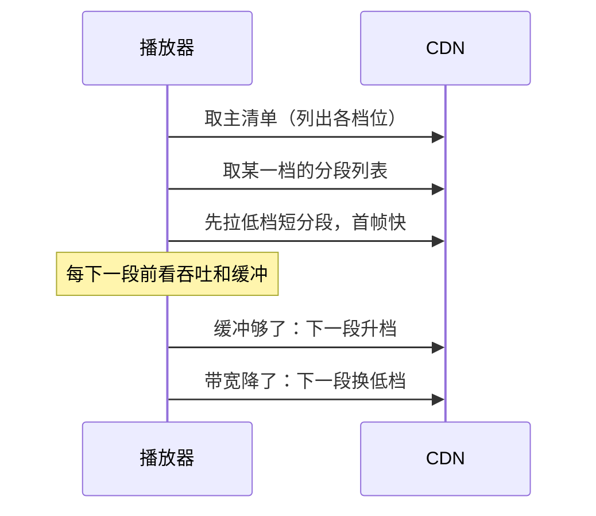

## Q
**播放协议：清单、分段、ABR**｜模拟面试补强 · 视频平台（YouTube）

面试官：「播放器怎么根据网速自动切清晰度？」

## A
**一句话。** HLS/DASH：主清单列出各档位，每档是一串 2–6 秒的分段；播放器按测到的带宽和缓冲区逐段选档位（ABR）。

**要点。**
- 客户端拿到什么？：先取主清单（master playlist），再取某一档的分段列表，按段请求 CDN。
- 怎么切档？：每下一段前看吞吐和缓冲，带宽降了下一段就换低档，不用重新开始播放。
- 首帧怎么快？：开头先拉低档位的短分段，缓冲够了再升档。
- 分段多长？：2–6 秒，短了请求多、长了切档慢。

**常见失分。**
- 只讲到「未命中就退回低清晰度」，没讲清单和分段，ABR 停在口号。
