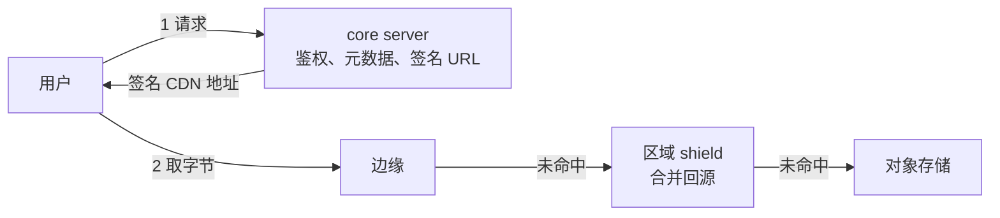

## Q
**核心服务不碰字节：CDN 回源**｜模拟面试补强 · 视频平台（YouTube）

面试官：「边缘没命中时，为什么不让你的 core server 直接把视频字节发给用户？」

## A
**一句话。** CDN 直接从对象存储回源（pull-through），中间加一层 shield 合并回源请求；core server 只做控制面：鉴权、元数据、签名 URL。

**要点。**
- 边缘未命中怎么走？：边缘 → 区域 shield → 对象存储，取回后逐层缓存。
- shield 解决什么？：热门视频同时在很多边缘未命中时，只回源一次，保护源站。
- core server 干什么？：返回元数据和带签名的 CDN 地址，字节流量完全不经过它。

**常见失分。**
- 先让 core server 直接发字节，被追问才改；1 TB/s 的读流量绝不能经过应用服务器。
