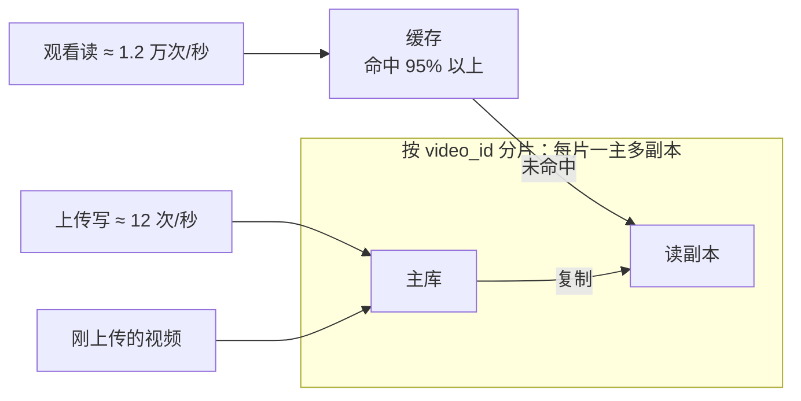

## Q
**元数据库怎么扛十亿次观看**｜模拟面试补强 · 视频平台（YouTube）

面试官：「每天十亿次观看，元数据库怎么扩？」

## A
**一句话。** 读多写少：元数据前面放缓存挡掉绝大多数读，数据库按 video_id 分片、每片加读副本；热门视频的元数据长期留在缓存。

**要点。**
- 读写各多少？：观看 ≈ 1.2 万次/秒平均（峰值几万），上传只有约 12 次/秒。
- 分片键选什么？：video_id，查询都按视频取，分布均匀；按作者查的列表另建索引表。
- 缓存挡多少？：头部视频占绝大多数观看，缓存命中率能到 95% 以上，数据库只扛剩下的。
- 写延迟能接受吗？：读副本有复制延迟，刚上传的视频读主库或带版本号。

**常见失分。**
- 只答到计数缓存，没讲分片键、读副本和缓存层。
