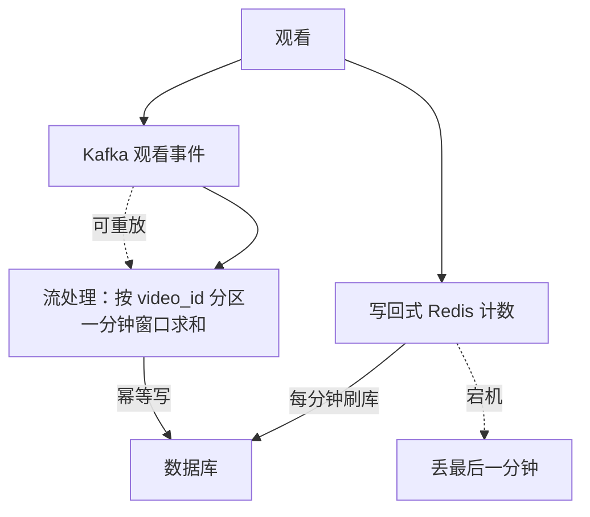

## Q
**观看计数：缓存宕机会丢**｜模拟面试补强 · 视频平台（YouTube）

面试官：「观看数先写 Redis 每分钟刷库，Redis 挂了怎么办？」

## A
**一句话。** 写回式缓存宕机会丢最后一分钟的计数；要不丢就把观看事件写进 Kafka，用流处理按窗口聚合后写库，可重放。

**要点。**
- 丢多少？：最后一次刷库之后的所有增量，节点故障时整段丢失。
- Kafka 方案怎么做？：每次观看发事件，流处理按 video_id 分区、一分钟窗口求和，写库幂等。

- 热点视频怎么办？：同一 video_id 的计数拆成多个子 key 或先在本地聚合，避免单分区过热。
- 要绝对准吗？：观看数允许近似，展示可以用缓存值；计费类计数才必须走可重放的日志。

**常见失分。**
- 没提持久性：Redis 写回的丢数据风险要主动说，并给出日志或流聚合的替代。
