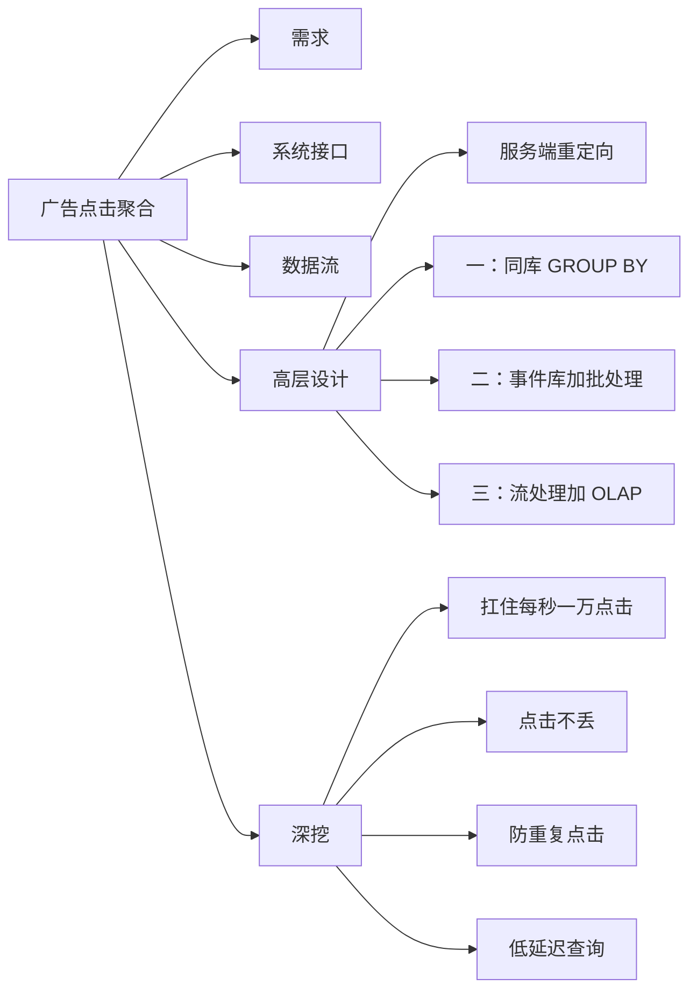

## Q
**广告点击聚合 · 这道题的地图**｜通览

广告点击聚合这道题按什么顺序讲？先定下哪些约束，整道题的关键直觉是什么？

## A
**一句话。** 难在峰值每秒 1 万次点击既不能丢、不能重复计，又要让广告主近实时查到按分钟聚合的数字。答案是服务端重定向记点击，写入流，用流处理预聚合进 OLAP 数据库。

**先定下的约束。**
- **范围外：** 广告定向、投放、跨设备追踪。
- **非功能需求：** 峰值 1 万次/秒（平均约 1000）；查询亚秒；不丢点击；尽量实时；同一点击只算一次。
- **核心实体：** 原始点击事件，按广告和分钟聚合的结果。
- **API：** `/click`（记录后 302），按时间查指标，最小 1 分钟。

**关键直觉。**
- **写多读少：** 把算的活提前到写入路径，查询只读结果；批处理延迟几分钟且突发越积越慢，所以上流处理。
- **丢点击比重复糟糕：** 重复能对账修正，丢了找不回，所以先写流再写缓存，原始事件另落数据湖重算比对。
- **幂等键来自展示，不来自用户：** 再营销会合法地多次展示同一广告，所以每次展示发一个签名 ID，入流前去重。
- **热点靠后缀：** 按广告 ID 分片，只给热广告的键加随机后缀，写 OLAP 时合并。

**容易漏的细节。**
- **窗口按事件时间：** 水位线决定何时关窗，更晚的点击靠对账修正。
- **独立用户数不能把分钟值相加：** 要存可合并的草图（HyperLogLog）。
