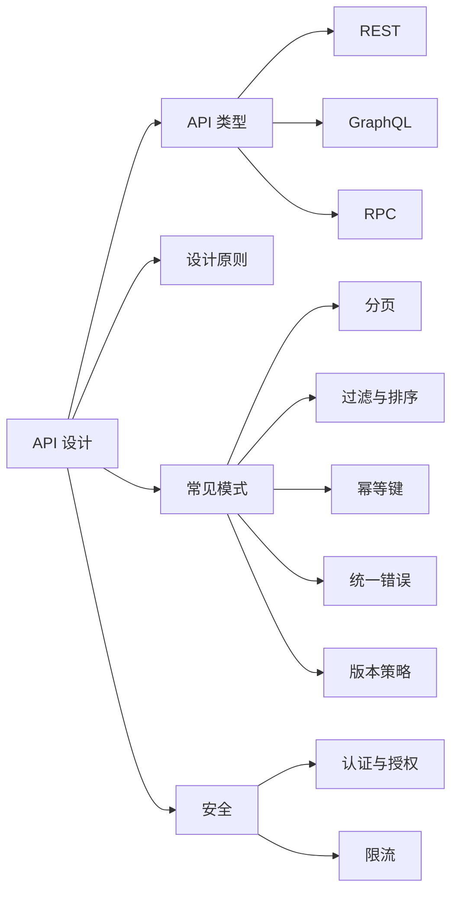

## Q
**API 设计 · 这一章的地图**｜通览

API 设计要解决什么问题？有哪几块，靠哪几个直觉串起来？

## A
**一句话。** API 是系统对外的契约：先选协议，再按原则和常用模式把它设计干净，并做好安全，整件事别超过约 5 分钟。

**关键直觉。**
- **重试安全是主线：** 网络会在请求中途断，客户端只能重试。判断能否重试看"重复执行后状态是否相同"，不看方法名；POST 创建类请求靠幂等键补上。
- **无状态和可吊销是一对取舍：** JWT 验签即放行、不查库，所以过期前收不回；API Key 要查表，删一条记录就吊销。
- **分页选哪种看数据会不会动：** 数据稳定又要跳页用偏移；会有插入删除、只往下翻用游标，偏移会重复或漏项。
- **路径放必需的，查询参数放可选的：** 没有它请求不成立的进路径，过滤、排序、分页都是可缺省的修饰。

**容易漏的细节。**
- **幂等键的边界：** 同键不同请求体要拒绝（常见 422）；并发同键要原子占位（唯一约束或 Redis `SET NX`），先查后存会双扣；保留期要长于客户端的重试窗口。
- **游标要带唯一决胜键：** 只按 `created_at` 排序，同一时刻的多行会漏或重复，要加主键 `id` 做第二排序键。
- **GraphQL 对外要防大查询：** 限深度和复杂度，列表强制上限，限流按成本算，不按请求数。
