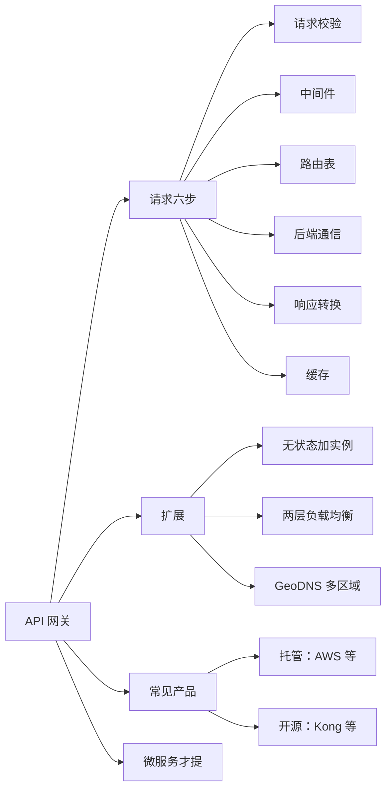

## Q
**API 网关 · 这一章的地图**｜通览

API 网关要解决什么？有哪几块，靠哪几个直觉让它保持薄？

## A
**一句话。** 微服务拆开后，客户端不该认识每个服务；API 网关做单一入口，核心是路由，顺带统一处理鉴权、限流等横切逻辑。

**关键直觉。**
- **便宜的检查在前：** 先校验格式，再鉴权限流，最后才碰后端，注定失败的请求越早拦住越省后端算力。
- **薄是底线：** 协议转换、聚合、细粒度授权都会让网关变厚，最终成为新的单体和发布瓶颈。
- **无状态才能直接加实例：** 本机限流计数、本机缓存一放进去，扩展就要先把状态外移。

**容易漏的细节。**
- **慢比挂更危险：** 后端变慢时连接堆积，会拖垮整个入口；要每个后端独立超时、只重试幂等请求、熔断、连接池隔离。
- **限流各实例各计数会放大：** 一个用户被打散到 N 个实例，放行量最多是限额的 N 倍。
- **网关验过身份，下游仍要防绕过：** 网关被绕开时服务就裸奔；身份头要保证外部伪造不了。
