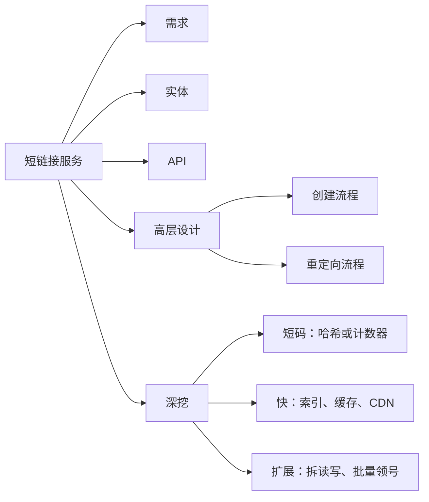

## Q
**短链接服务（Bitly） · 这道题的地图**｜通览

短链服务这道题按什么顺序讲？先定下哪些约束，整道题的关键直觉是什么？

## A
**一句话。** 这是读写极度失衡的键值映射，难点只有两个：短码怎么保证唯一，重定向怎么足够快。

**先定下的约束。**
- **范围外：** 账号管理、点击分析、垃圾链接过滤。
- **非功能需求：** 短码唯一；重定向低于 100ms；可用性 99.99%，可用性优先于一致性；10 亿条短链、1 亿日活，读写约 1000:1。
- **核心实体：** 原始 URL、短 URL、用户。
- **API：** `POST /urls`（`long_url`、可选别名和过期时间），`GET /{short_code}` 返回 302。

**关键直觉。**
- **读写比 1000:1 决定了后面所有选择：** 写入每秒约 1 行，单库放得下，难处全在读，所以缓存、读写拆分都冲着读去。
- **302 而不是 301：** 301 会被浏览器长期缓存，之后改不了也撤不掉。
- **哈希与计数器的差别在谁来协调：** 哈希无需协调但会碰撞，要靠 UNIQUE 约束加盐重试；计数器不碰撞但多实例要共用，所以批量领区间。
- **唯一性靠两层：** 发号器尽量不重，数据库约束兜底。

**容易漏的细节。**
- **Redis 故障转移后计数器会倒退：** 异步复制丢的是增量，重复发号，不是跳号。
- **顺序码能被枚举：** 编码前与秘密密钥异或。
- **302 也能被缓存：** 带短 `max-age`，用撤销延迟换命中率。
