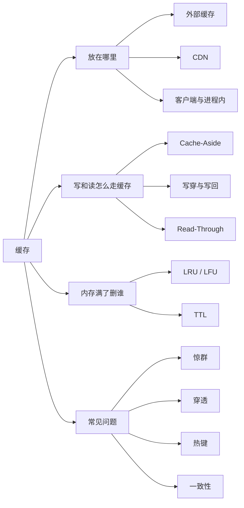

## Q
**缓存 · 这一章的地图**｜通览

缓存要解决什么问题？有哪几块，靠哪几个直觉串起来？

## A
**一句话。** 读数据库太慢或太贵时，把常读数据放进快的内存，换来更低延迟和更少的库压力，代价是过期、失效和故障要管。

**关键直觉。**
- **数据库扛的是未命中量：** 命中率从 90% 到 99%，库的读压力降到十分之一。所以容量要按缓存全失效的最坏情况算，5 万 QPS 全落到只能扛 2000 的库上就是事故。
- **越靠近用户越快，也越难失效：** 进程内各实例各存一份，一个作废了别的不知道；要全局一致的数据放得越集中越好。
- **写策略分的是谁来保证两边一致：** Cache-Aside 由应用负责，缓存挂了还能读库；写穿同步写两边，读最新但写慢；写回异步刷库，写最快但崩溃会丢数据。
- **LRU 管内存，TTL 管新鲜度：** 热键可以几天不被淘汰，数据早就过期了，所以两个要一起用。

**容易漏的细节。**
- **回填会写进旧值：** 读库拿到 v1 的请求还没回填，另一个请求已更新库并删了缓存，v1 随后被写入，一直留到 TTL 过期。租约可挡住，没有租约就靠写后删加短 TTL。
- **穿透不是惊群：** 惊群是一个热键过期，用请求合并；穿透是大量根本不存在的键，用短 TTL 的负缓存或布隆过滤器。
- **预热只对 TTL 驱动有效：** 靠写入时删除失效的，失效时刻不可预测。
