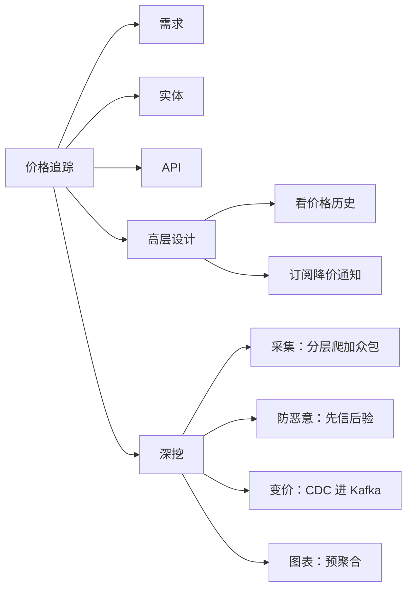

## Q
**价格追踪（CamelCamelCamel） · 这道题的地图**｜通览

价格追踪这道题按什么顺序讲？先定下哪些约束，整道题的关键直觉是什么？

## A
**一句话。** 难点不在读，在数据从哪来：亚马逊没有接口还限速，5 亿商品爬不完。答案是把 100 万 Chrome 扩展用户变成分布式采集网络，再用爬虫抽查，价格一变就发事件通知。

**先定下的约束。**
- **范围外：** 搜索、跨店比价、评论；强一致价格、分钟级实时价。
- **非功能需求：** 可用性优先于一致性；5 亿商品；历史查询低于 500ms；降价后 1 小时内通知。
- **核心实体：** Product、User、Subscription、Price（时序）。
- **API：** `GET /products/{id}/price`（周期、粒度），`POST /subscriptions`。

**关键直觉。**
- **采集是藏在需求背后的需求：** 每 IP 每秒约 1 次，全量按周爬也要上千个 IP，所以分层，再让扩展分担。
- **信任跟着风险走：** 共识投票对冷门商品太慢，闪购结束都凑不齐人；先信后验只把降幅大、信誉低的排进验证爬取。
- **事件驱动的成本只跟变化数成正比：** 缩短定时任务也能满足 1 小时，但成本随库增长、任务会重叠。
- **只在向下穿越阈值时通知：** 价格涨回阈值之上后，再跌破才会再发。

**容易漏的细节。**
- **双写会静默丢事件或造幻影事件：** CDC 或事务性发件箱才可靠。
- **预聚合表隔夜滞后：** "当前价"要读最新价，不能读聚合表。
