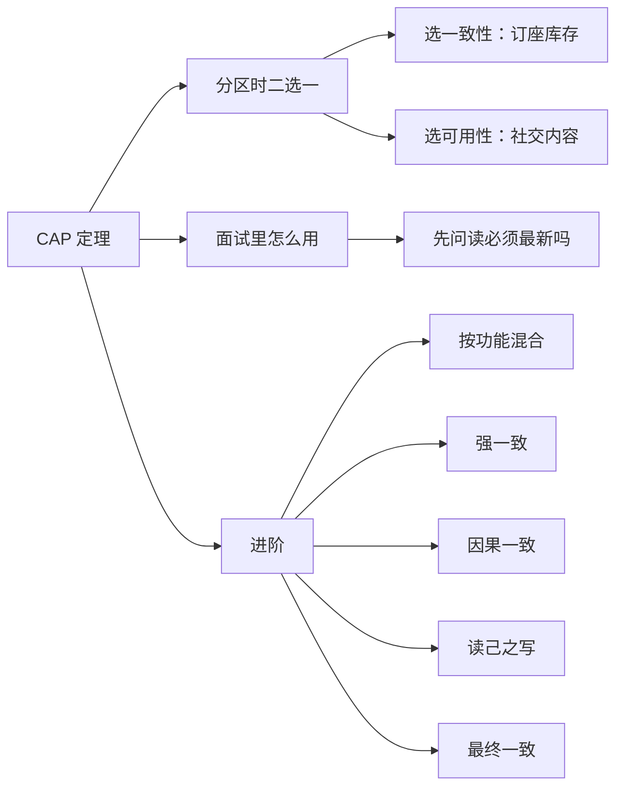

## Q
**CAP 定理 · 这一章的地图**｜通览

CAP 定理要解决什么问题？有哪几块，靠哪几个直觉串起来？

## A
**一句话。** 分布式系统里网络分区一定会发生，真正的选择是分区时保一致性还是保可用性，这个选择要在非功能需求阶段先定。

**关键直觉。**
- **分区躲不掉，选择只在分区时：** 没有分区时一致性和可用性兼得；真正的 CA 只存在于单节点。
- **选一致性不等于整体停摆：** 多数派一侧照常服务，只有少数派一侧拒绝请求，换来不出现分叉数据。
- **选可用性要自己处理冲突：** 两侧都接受写，之后要合并。最后写入为准会静默丢数据；购物车取并集，删除要用墓碑。
- **判据是短暂不一致是不是灾难：** 订座要一致，浏览可以最终一致，强一致只放在真需要的路径。

**容易漏的细节。**
- **CAP 的两个字比日常说法窄：** C 是线性一致，不是 ACID 的 C；A 要求每个请求都有响应，不是 99.99% 运行时间。
- **没有分区也要付延迟：** 强一致要等多数派确认，跨地域一次写几十到几百毫秒（PACELC）。
