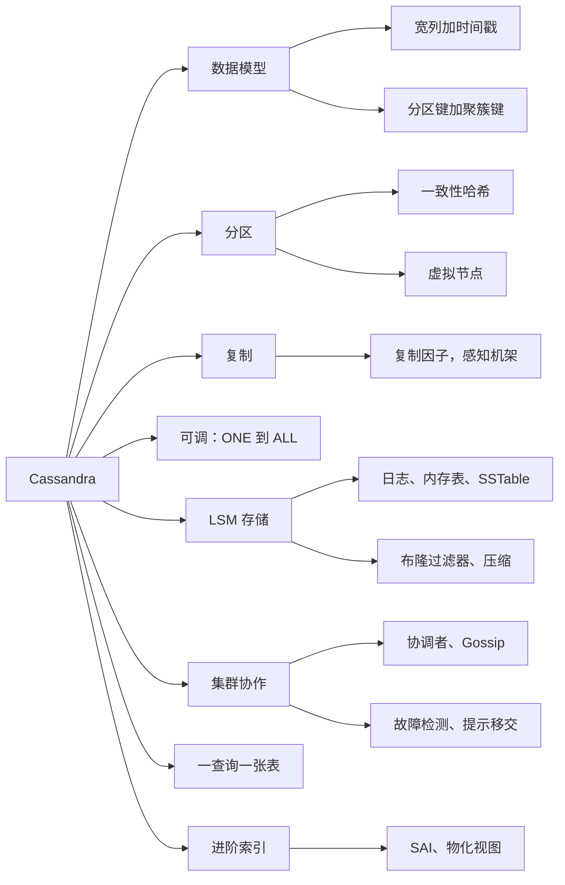

## Q
**Cassandra · 这一章的地图**｜通览

Cassandra 靠哪几块做到高写入、高可用？哪几个直觉决定怎么用它？

## A
**一句话。** 要存海量数据、承受高写入又要始终可用，Cassandra 用一致性哈希分区、无主复制和 LSM 树存储，代价是查询灵活性和强一致。

**关键直觉。**
- **分区键同时决定三件事：** 数据落哪些节点、查询能不能高效、分区会不会无限变大；所以先列访问模式，再一查询一张表，大分区加时间桶。
- **写便宜，读和删贵：** 只追加让写极快；读要合并多个文件，删除写的是墓碑，读得越靠近刚删的区域越慢。
- **一致性是读写个数相加：** 读加写的个数大于复制因子才保证重叠；3 副本读写都用 QUORUM，容忍一个副本宕机。
- **短故障靠暂存，长故障靠修复：** 宕机节点留在环上不触发搬迁，hint 只管短期，久了要修复或重建。

**容易漏的细节。**
- **墓碑宽限期默认 10 天：** 须在期内对每个节点修复一遍，否则错过删除的副本会让已删数据复活。
- **最后写入胜出靠时钟：** 时钟偏差会让晚写被旧值覆盖，且不报错；要条件写用 LWT，多轮往返只留给少数关键位置。
- **批处理是为原子不是提速：** 跨多个分区的大批会拖垮协调者。
