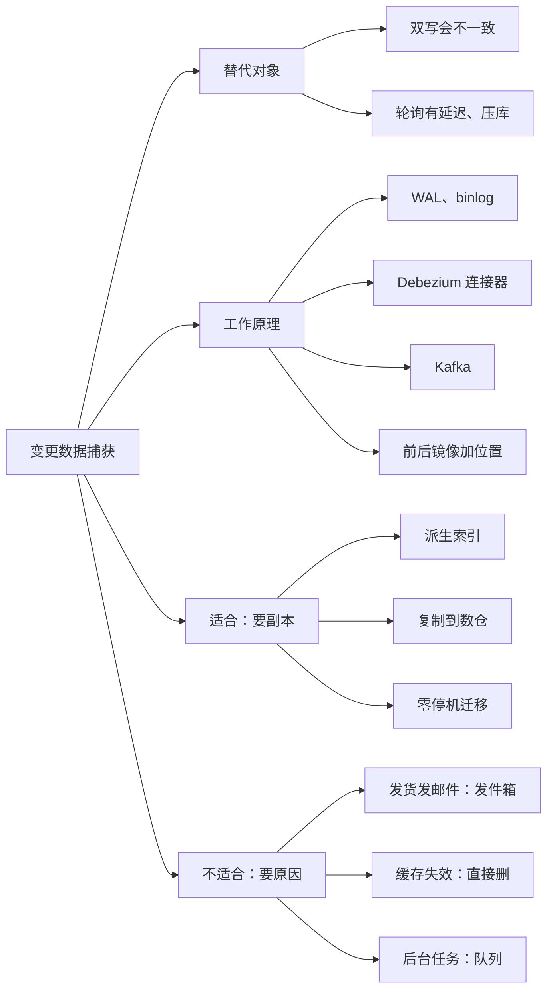

## Q
**变更数据捕获 · 这一章的地图**｜通览

变更数据捕获替代了什么？哪几块组成它，什么场景用、什么场景不能用？

## A
**一句话。** 让另一个系统跟上主库的每次变化，不靠双写或轮询，而是读主库自己的变更日志；它只适合下游要一份副本的场景。

**关键直觉。**
- **CDC 只知道变了什么，不知道为什么：** 迁移脚本、修复脚本改出的行和真实发货一模一样，所以副作用不能靠行变更去猜。
- **适合的三个条件是同一件事：** 源始终权威、下游可滞后、下游可重建；满足了，出问题就删掉下游重来。
- **至少一次，所以下游要幂等：** 按主键 upsert，同一主键进同一分区保序；真要去重，靠业务事件的 ID，不靠日志位置。

**容易漏的细节。**
- **复制槽会撑满主库磁盘：** 连接器停摆，Postgres 就不能回收对应的 WAL；要监控落后字节，并设 `max_slot_wal_keep_size` 上限（默认不限），超限后下游要重做快照。
- **迁移要先开 CDC 再回填：** 顺序反了，拷贝开始到 CDC 启动之间的变更永久丢失。
- **旧值默认不全：** Postgres 默认只在更新和删除里带主键，要完整的 before 镜像得设 `REPLICA IDENTITY FULL`。
