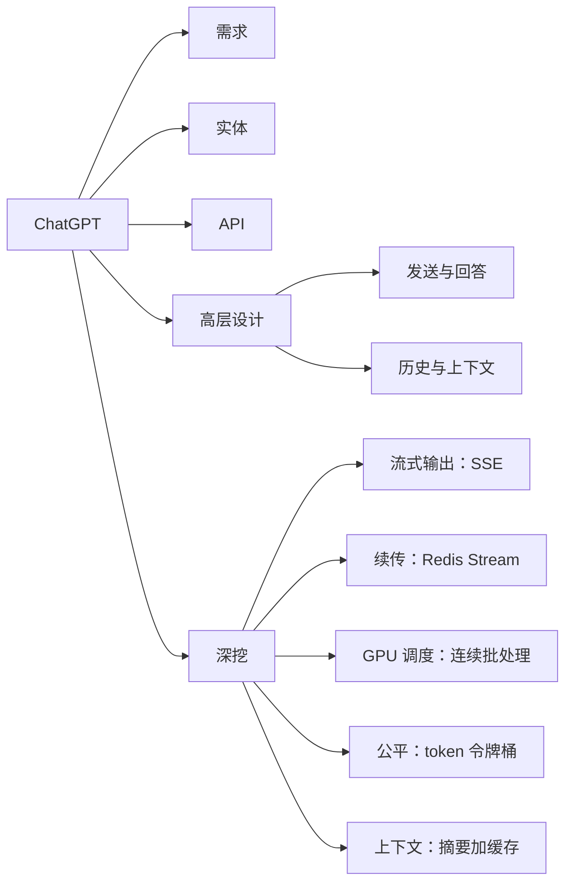

## Q
**ChatGPT · 这道题的地图**｜通览

ChatGPT 这道题按什么顺序讲？先定下哪些约束，整道题的关键直觉是什么？

## A
**一句话。** 业务逻辑很薄，难点是服务昂贵稀缺的 GPU：回答要流式输出，断线要能续传，GPU 要排队并公平分配，对话越长成本越高。token 是模型每次吐出的一小段文字。

**先定下的约束。**
- **范围外：** 编辑分支、多媒体、分享、工具。
- **非功能需求：** 首个 token 低于约 500 ms；流断了不丢；可用性优先；两个层都公平；峰值约 2 万提示词/秒、12 万路并发流。
- **核心实体：** User、Chat、Message，深挖里加 Run。
- **API：** `POST /chats`、`POST /chats/{chatId}/messages`、`GET /chats`、`GET /chats/{chatId}/messages`。

**关键直觉。**
- **容量按并发流算，不按请求数：** 并发等于到达率乘时长（Little 定律），回答时长翻倍，连接数和 GPU 槽位也翻倍。
- **传输看数据流向：** 生成时只有服务器往下推，SSE 够了；持续双向（如语音打断）才值得 WebSocket。
- **队列吸收的是尖峰，不是长期超载：** 深度上限等于能容忍的排队时间乘处理速率，超了就拒绝。
- **缓存把上下文成本从平方压回线性：** 50 轮全量重发要发约 64 万输入 token，前缀缓存全命中约 2.5 万；窗口上限靠摘要。

**容易漏的细节。**
- **每个 token 发增量：** 重发全文总量随长度平方增长。
- **工作者中途崩溃不能直接重派：** 采样有随机性，续写会拼出乱文；只在未输出时自动重试，或带上已出的 token 重新预填充。
- **取消和完成可能同时到：** 状态转换用条件更新，终态之后不再改。
