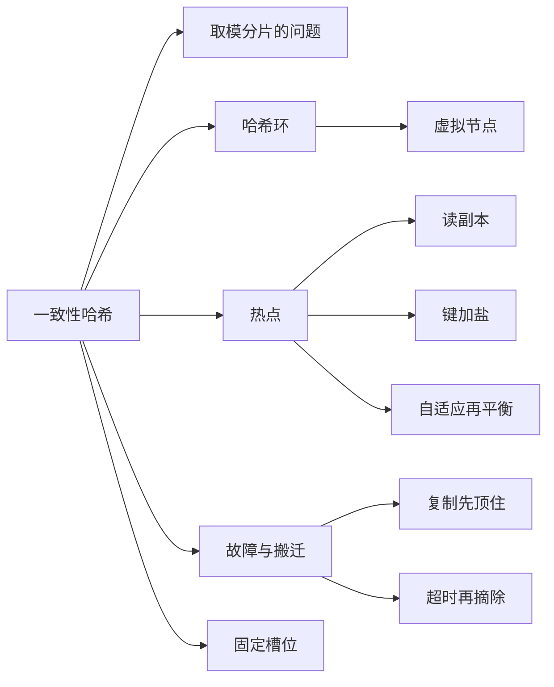

## Q
**一致性哈希 · 这一章的地图**｜通览

一致性哈希要解决什么问题？有哪几块，靠哪几个直觉串起来？

## A
**一句话。** 增删服务器时，取模分片会让几乎所有数据换机器；把数据和机器放在一个环上，只有相邻一段需要搬。

**关键直觉。**
- **取模的病根是映射依赖机器总数：** 5 台扩到 6 台，约 83% 的键换机器，缓存命中率崩掉；环只搬约 1/6。固定槽位同理。
- **虚拟节点平衡键数，管不了热键：** 一个键只能落在一台机器上。单键流量过高用副本或加盐。
- **环只决定归属，不负责扛故障：** 副本先顶住，持续超过阈值再摘除；立刻摘会让邻居接手一批空缓存，恢复后又搬一次。
- **环和槽位换的是不同东西：** 环去中心化、自动适应；槽位是显式小表，好推理、能精确迁移，但要控制面分配。

**容易漏的细节。**
- **虚拟节点不是越多越好：** 每台几十到几百个够了，再多路由表变大；强机器多放点来加权。
- **加盐的代价在写：** 热键拆成十份，读随机一份，写要写全部十份。
