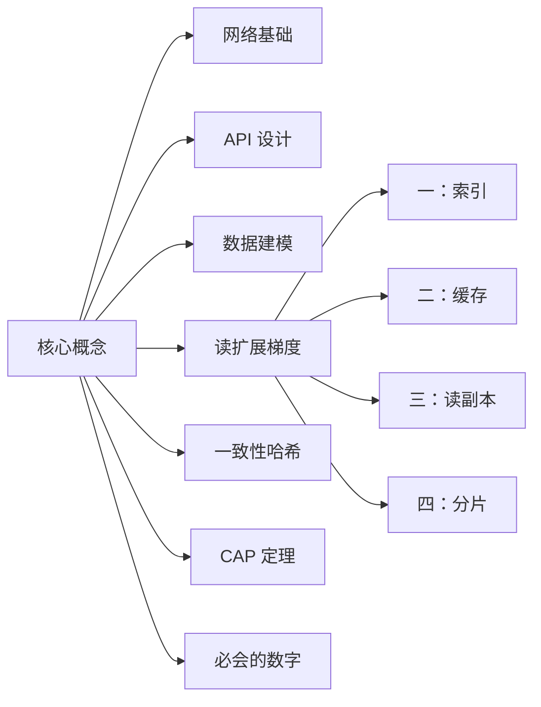

## Q
**核心概念速览 · 这一章的地图**｜通览

核心概念速览要解决什么问题？有哪几块，靠哪几个直觉串起来？

## A
**一句话。** 核心概念是与技术无关的基础构件，几乎每道题都用到，面试官默认你懂并会追问；用法是先给默认，出现触发信号再升级。

**关键直觉。**
- **每个默认都带一个换掉它的信号：** 没有信号就不换；一提实时就上 WebSocket、300 GB 就分片，都是没等信号。
- **读扩展一级一级往上走：** 每级的代价都得说，索引拖慢写，缓存带来失效，副本带来读到旧数据，分片带来跨分片查询。
- **数字决定要不要升级：** 在要做决定时才估算，用现代量级；单库每秒数万查询，500 GB 提分片是白增复杂度。
- **一致性按功能分，不按系统分：** 钱、库存、订座走强一致，浏览和搜索接受最终一致；强一致的路径网络健康时也更慢。

**容易漏的细节。**
- **派生数据都是最终一致：** 搜索索引、缓存、副本都靠异步复制出来，刚写完的用户可能读不到，关键路径读主库。
- **NoSQL 的键要先对着查询定：** 按 `user_id` 分区，取某用户的帖子是单分区查询，按话题标签找帖子要扫全表。
