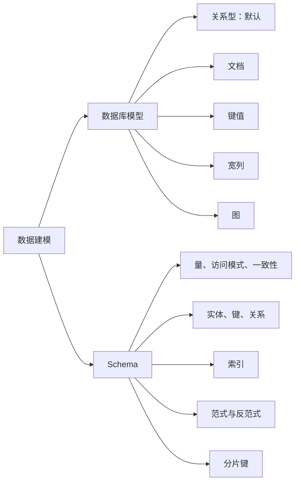

## Q
**数据建模 · 这一章的地图**｜通览

数据建模要解决什么问题？有哪几块，靠哪几个直觉串起来？

## A
**一句话。** 先选对数据库类型，再依据数据量、访问模式、一致性要求设计表结构，默认关系型，别为显得高级选冷门库。

**关键直觉。**
- **访问模式是起点：** 选库、建索引、反范式、选分片键都从"最主要的查询是什么"推出来，不看技术名气。
- **默认关系型，其他是拿能力换一个强项：** 文档换嵌套读，改一处要重写整份；键值换极快，只剩按键取；宽列换海量追加写，要围绕查询复制数据。
- **反范式是把一致性的账记到写上：** 事实来源保持范式化，前面的缓存或计数是可重建的派生品。
- **规模会拿掉联接和外键：** 联接跨分片很贵，外键跨库根本做不到，改成应用层校验加冗余快照，再定期对账。

**容易漏的细节。**
- **ACID 不保证业务不变量：** 默认的读已提交下，两个事务各读到库存 1 再各减一会超卖；写成原子 `UPDATE ... WHERE stock > 0` 或加行锁。
- **分片键基本不可改：** 按 `conversation_id` 分，超大群聊又成热键，要再加桶号打散。
- **随机 UUID 拖慢大表写入：** 随机落在任意叶子页造成页分裂；时间有序的 UUIDv7 基本追加到索引尾。
