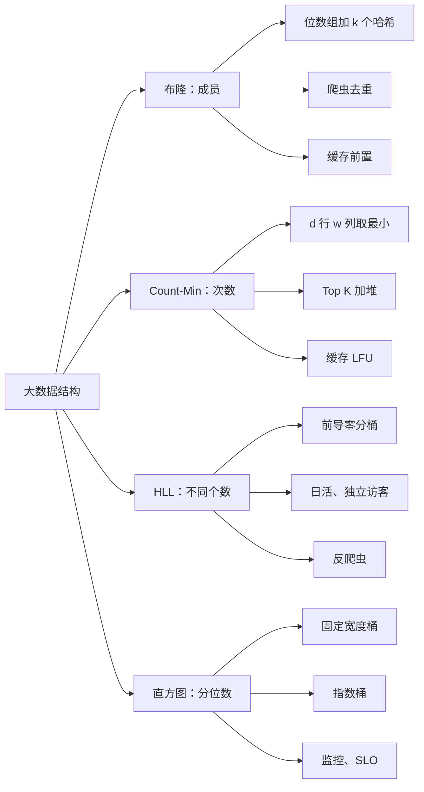

## Q
**大数据结构 · 这一章的地图**｜通览

数据大到哈希表装不下时，四种近似结构各答什么问题，选哪个、值不值得上靠什么判断？

## A
**一句话。** 数据大到哈希表装不下时，用四种近似结构，拿一点可控的误差换有界的内存。

**关键直觉。**
- **先问容忍哪个方向的误差：** 布隆只会假阳性，Count-Min 只会偏大；放在精确系统前面，错了也只是多做一步，不会出错。
- **哈希表装得下就别上：** 10 亿元素、1% 误判约 1.2 GB，只比哈希表省约 75%；面试里先用最简单的，遇到内存瓶颈再升级。
- **精度很贵：** 误判率降到十分之一，布隆每元素多约 4.8 比特；HyperLogLog（HLL）内存翻倍，误差只降到约 0.7 倍。

**容易漏的细节。**
- **布隆放在缓存前会越用越糊：** 缓存会过期淘汰，过滤器不能删；别的写入方写进缓存的键也会被判成不在。
- **分位数不能平均：** 多台机器要按同样的桶边界上报计数，相加后再算。
- **SLO 阈值要落在桶边界上：** 否则桶内的请求在阈值两侧，判不出；桶也要覆盖大多数请求所在的范围。
