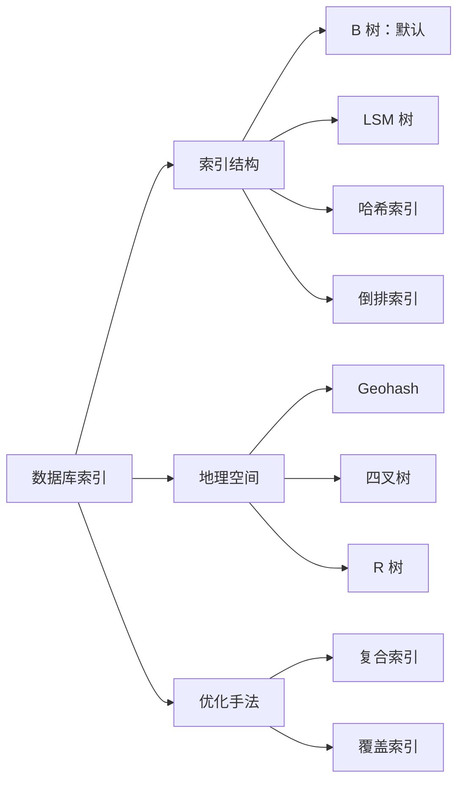

## Q
**数据库索引 · 这一章的地图**｜通览

数据库索引要解决什么问题？有哪几块，靠哪几个直觉串起来？

## A
**一句话。** 没有索引就要逐页扫全表，索引用额外的数据结构直接定位到数据页，代价是空间和写入变慢；按查询形态选对结构是关键。

**关键直觉。**
- **按访问方式倒推结构：** 等值加范围加排序用 B 树，海量写入用 LSM，邻近用地理索引，全文用倒排；先问查询怎么查，再问用什么。
- **每个索引都是拿写和空间换读：** 每次写要改所有索引，12 个索引就是几倍写放大；LSM 没有更快，只是把成本挪到读和压实。
- **复合索引看列的顺序：** 只能用最左前缀，等值列放前面，范围或排序列放后面，排序也能一并省掉。
- **B 树很矮：** 一页存几百个键，一亿行也才 3 层，上层几乎总在缓存里。

**容易漏的细节。**
- **有索引不等于用得上：** 列上套函数、`LIKE '%abc'`、类型隐式转换会失效；命中过半行时优化器宁可全表扫。先看 `EXPLAIN`。
- **Geohash 的边界：** 相邻格子的前缀可能完全不同，要查自己加 8 个邻格，再用真实距离过滤。
- **随机主键拖慢写入：** UUIDv4 到处页分裂；自增或时间有序的键总在最右叶子追加。
