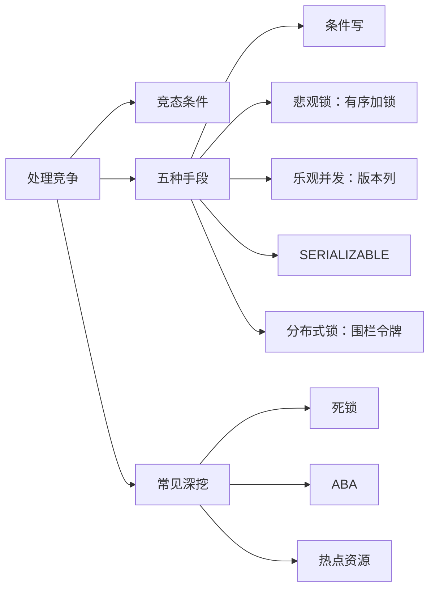

## Q
**处理竞争 · 这一章的地图**｜通览

处理竞争要解决什么问题？五种手段有哪几块，靠哪几个直觉串起来？

## A
**一句话。** 多个请求同时争同一资源会读到过期数字而超卖，办法是在权威数据源上用比较并设置，按从简到重的五种手段选。

**关键直觉。**
- **守卫必须落在被争抢的那个东西上：** 数据库只保护它看得见的冲突；计数器写得再对，也管不住两条订单写进同一个座位，要一座一行。
- **选型看的是冲突频率和判断放在哪：** 判断能写进 WHERE 就条件写；要读完再算，冲突多先加锁，冲突少用版本检查。
- **越往后越贵：** SERIALIZABLE 要重试，分布式锁多一个组件，所以先留在一个数据库里，够用的最简单工具优先。
- **热点行扩展不了：** 争抢在同一行，分片、负载均衡、读副本都拆不开；只能改问题（拆资源）或排队让一个工作者串行处理，吞吐封顶。

**容易漏的细节。**
- **零行不是错误：** 条件 UPDATE 没匹配到行，语句照样成功，后面的 INSERT 照常执行；必须读受影响行数，为 0 就回滚。
- **可重复读挡不住写偏斜：** 两人各锁各的行，没有共同的行可锁；要 SERIALIZABLE，或把约束落到单行。
- **带 TTL 的锁不保证不重叠：** 持有者停顿过了期，醒来还会写；检查要在存储端比较单调递增的令牌。
