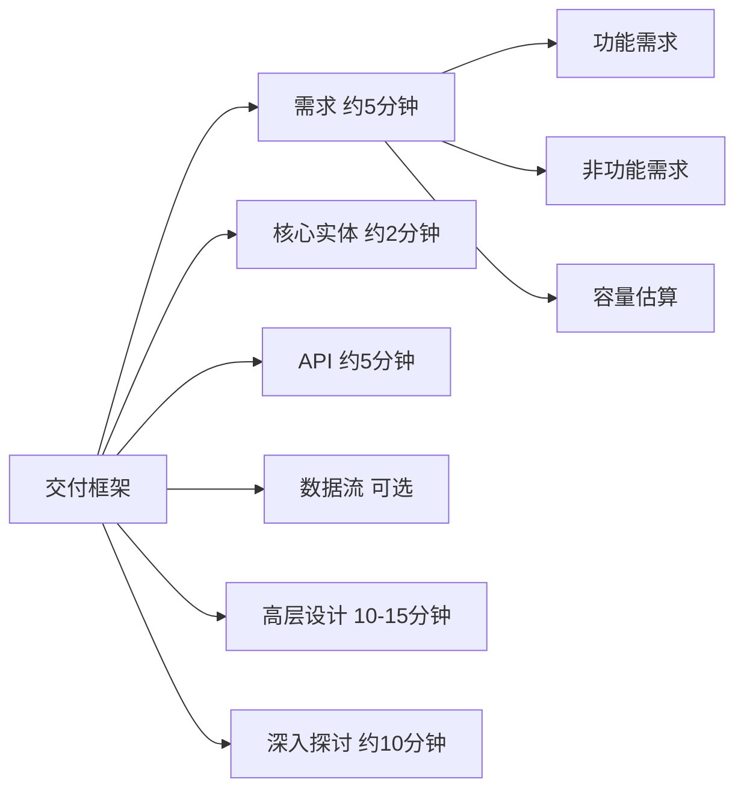

## Q
**交付框架 · 这一章的地图**｜通览

交付框架要解决什么问题？有哪几步，每一步为什么排在那里？

## A
**一句话。** 最常见的失败是没交付能用的系统，不是手速慢；框架给出固定步骤和用时，让精力落在面试官在意的地方，紧张时有路可退。

**关键直觉。**
- **前一步是后一步的验收标准：** 需求列了就得做，API 对应功能需求，高层设计逐个端点搭，深入探讨把每条非功能需求落到一个设计决策上。
- **筛选需求本身在被评分：** 功能需求只留约三项，需求越长，后面越没时间满足它们。
- **复杂度留给深入探讨：** 高层设计只搭满足核心功能的简单版，缓存、队列口头点一下就走；在这里展开会拖到做不完整个方案。
- **估算只在结果改变设计时做：** 它是在推理哪些架构可行，不是算术；例如热门话题 Top K 要先算话题数，才知道单个最小堆够不够。

**容易漏的细节。**
- **用户身份从认证令牌里取：** 放在请求体或路径参数里，别人就能冒充；关注接口只传被关注者的 ID。
- **非功能需求要量化并挑 3-5 项：** "低延迟"没有信息量，"搜索低于 500 毫秒"才指出了重点。
- **深入探讨不要抢话：** 越资深越要主动发现瓶颈，但要给面试官留出追问的位置。
