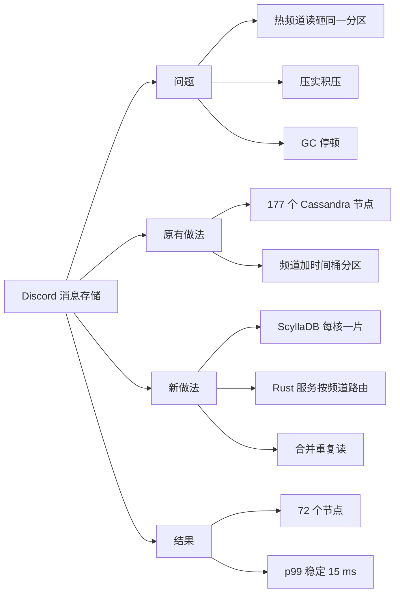

## Q
**Discord 消息存储 · 这个案例的地图**｜通览

Discord 消息存储的问题是什么，原来怎么做，改成什么，结果如何？为什么要两步？

## A
**一句话。** 177 个 Cassandra 节点存着万亿级消息，热门频道的读砸向同一分区；Discord 换成 ScyllaDB，并在前面用 Rust 数据服务合并重复读，节点降到 72 个，p99 读稳定在 15 ms。

**关键直觉。**
- **让每次读更便宜，和让读更少，是两个问题：** 换数据库解决库内的压实、GC 和单次读开销，合并解决热点。
- **更快的数据库去不掉热分区：** 每核一片把热点限制在负责它的那个核，只有这个核忙，但同一分区的读仍然都落到它；所以前面还要路由加合并。
- **合并的效果取决于重复请求能否在同一进程相遇：** 一次读 20 ms 时，同一个键每个实例每秒最多约 50 次数据库读；按频道路由到 1 个实例，1 万次/秒降到约 50，随机分到 20 个实例只降到约 1000。
- **合并不存结果，所以比缓存更不容易读到旧值：** 编辑后新发起的读是新查询；缓存则要在编辑时失效，并处理回填的竞态。

**容易漏的细节。**
- **Cassandra 的删除要延后到读和压实：** 删除写入墓碑，默认保留 10 天，读分区时要扫过墓碑；压实积压会让它更慢。
- **合并的坑：** 第一个请求失败会让所有等待者一起失败；键要包含所有影响结果的参数，如权限和分页游标。
