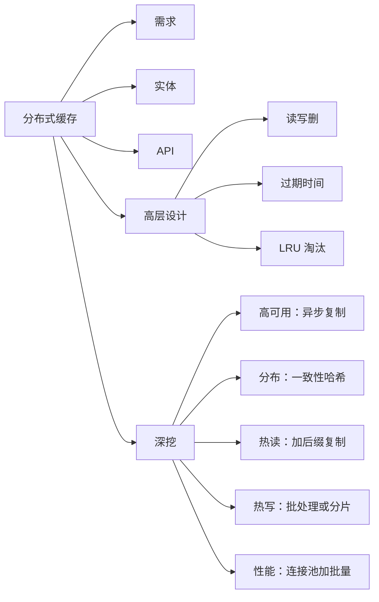

## Q
**分布式缓存 · 这道题的地图**｜通览

分布式缓存这道题按什么顺序讲？先定下哪些约束，整道题的关键直觉是什么？

## A
**一句话。** 一半是单机的低层设计，哈希表加双向链表让读写和淘汰都是 O(1)；另一半是怎样把它变成多机集群，要答复制、分片、热键和网络开销。

**先定下的约束。**
- **范围外：** 持久化、强一致、复杂查询、事务；缓存大小可配置先不做。
- **非功能需求：** 高可用，最终一致可接受；get 和 set 低于 10ms；1TB 数据、峰值 10 万请求/秒。
- **核心实体：** 只有键和值。
- **API：** `POST /:key`、`GET /:key`、`DELETE /:key`。

**关键直觉。**
- **缓存拿一致性换速度与可用性：** 所以选异步复制，副本多了同步写反而更慢更脆；代价是主节点切换后可能读到旧值。
- **节点数由内存定，不由吞吐定：** 1TB 要几十台，吞吐只要 8 台；带副本内存再翻几倍。
- **热读和热写的解法方向相反：** 读热点复制，写热点拆分或合并；读写都热的键，复制会放大写。
- **一致性哈希把扩缩容变成局部事件：** 取模下 50 台加到 51 台，约 98% 的键换位置，缓存近乎全冷。

**容易漏的细节。**
- **异步复制丢的可能是 delete：** 新主上旧值留到 TTL 过期；设短 TTL，关键键把版本放进键名。
- **过期要同时从哈希表和链表删：** 只删一边，淘汰时会撞上幽灵节点。
- **热键过期瞬间会击穿：** 同一键只放一个请求回源。
