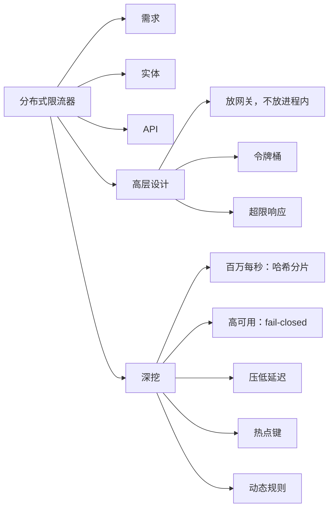

## Q
**分布式限流器 · 这道题的地图**｜通览

分布式限流器这道题按什么顺序讲？先定下哪些约束，整道题的关键直觉是什么？

## A
**一句话。** 每个请求都要做一次共享计数的读改写，难点在每秒 100 万次的计数怎么分片、保持原子、挂了怎么办；答案是网关加令牌桶，状态放分片的 Redis。

**先定下的约束。**
- **非功能需求：** 每次检查增加不到 10ms；高可用，最终一致即可；每秒 100 万请求、1 亿日活。
- **核心实体：** Rules、Clients、Requests。
- **API：** `isRequestAllowed(clientId, ruleId)`，返回是否放行、剩余次数、重置时间。

**关键直觉。**
- **限额只有在共享状态里才是全局的：** 放进应用进程，每台只见自己的流量，限额被放大成实例数乘限额。
- **读改写要在数据所在的节点一次做完：** 令牌桶的读、补、判、扣放进一个 Lua 脚本，否则两个网关会在读写之间互相插入。
- **分片数按检查次数算：** 每请求查两条规则就是 200 万次/秒，内存才约 20GB，瓶颈是读改写次数。
- **故障时的选择取决于保护谁：** 限流故障常和流量高峰同时发生，放行会打穿后端，所以这里选拒绝。

**容易漏的细节。**
- **多规则要同槽：** 脚本里的键必须在同一个槽，用哈希标签 `{user}` 把同一客户端的规则放在一起。
- **固定窗口在边界会放过两倍额度：** 滑动窗口计数器按比例折算上一窗口，只存两个数。
- **只有拒绝能在网关缓存：** 令牌最早补回之前一定不够。
