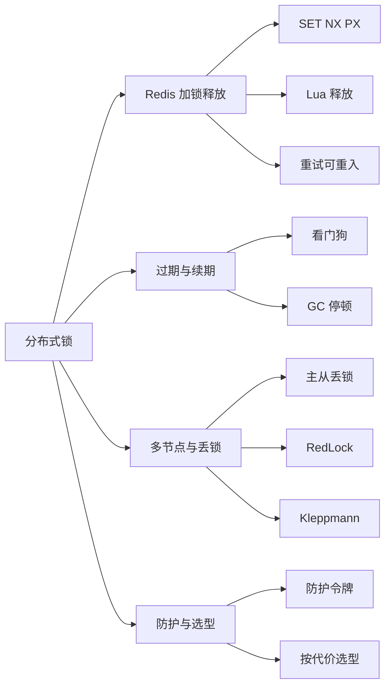

## Q
**分布式锁 · 这一章的地图**｜通览

分布式锁要解决什么问题？有哪几块，靠哪几个直觉串起来？

## A
**一句话。** 多实例部署时本地锁各管各的，要把「谁持有」放到共享的地方；但带期限的锁总有失效的缝，所以锁只是优化，正确性要靠下游兜底。

**关键直觉。**
- **先问重复一次的代价：** 只是多发一条通知，Redis 锁够用；是重复扣款，就由唯一键或条件更新兜底，锁只负责少干重复活。
- **每道安全措施补的是上一道的缝：** 加 TTL 防崩溃死锁，随机值加 Lua 防误删，看门狗防提前过期，令牌防冻住后醒来的旧持有者。
- **令牌的判断在资源端：** 只发号没用，下游记住见过的最大号，拒绝更小的。
- **RedLock 两头不讨好：** 效率型用单实例锁就够，正确性型它缺令牌又怕时钟，该用共识系统或数据库。

**容易漏的细节。**
- **能用一条 UPDATE 就不要锁：** `WHERE count > 0` 的条件更新，检查和扣减在同一条语句里。
- **Redis 发不出严格单调的号：** 主从切换后 `INCR` 的计数可能回退；ZooKeeper 的 zxid、etcd 的 revision 才行。
- **指定了租约时长就不续期：** 看门狗只在加锁没指定 `leaseTime` 时启用。
