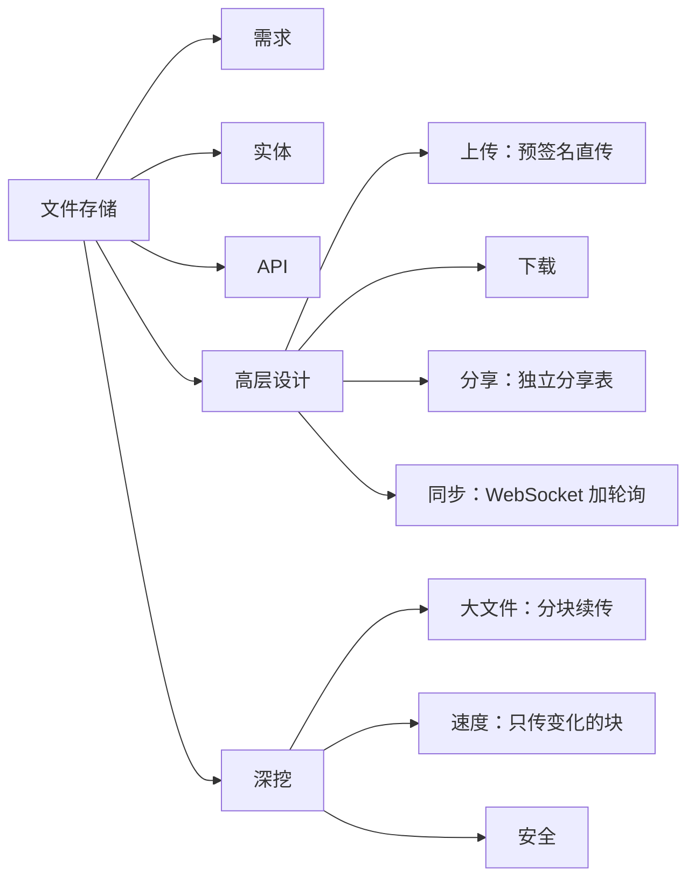

## Q
**文件存储（Dropbox） · 这道题的地图**｜通览

文件存储这道题按什么顺序讲？先定下哪些约束，整道题的关键直觉是什么？

## A
**一句话。** 字节和元数据分开，字节直传对象存储，服务器只做控制；难点是 50GB 大文件的可续传上传，以及多设备同步。

**先定下的约束。**
- **范围外：** 编辑文件、不下载就预览；每用户容量上限、文件版本。
- **非功能需求：** 可用性优先于一致性；文件最大 50GB；安全且丢了能恢复；上传、下载、同步尽量快。
- **核心实体：** File、FileMetadata、User。
- **API：** `POST /files`、`GET /files/{fileId}`、`POST /files/{fileId}/share`、`GET /files/changes?since=`。

**关键直觉。**
- **字节不经过应用服务器：** 服务器只发预签名 URL、记元数据状态（uploading 到 uploaded），所以它不会成为带宽瓶颈。
- **大文件靠幂等的小步骤：** 50GB 一次 POST 在 100Mbps 下约 1.1 小时，断了重来、没进度；分块后每块可单独重试，续传就是只补缺的块。
- **服务端不信客户端说传完了：** 用每块 ETag 加 `ListParts` 核对。
- **固定分块怕插入：** 开头插一字节，后面所有块都变；内容定义分块（滚动哈希）让只有改动处的块变。

**容易漏的细节。**
- **分段有硬限制：** 每块至少 5 MiB、最多 10000 块，50GB 用 5MiB 会超，要取 8–16MiB；未完成的分段继续收费，要设生命周期清理。
- **用时间戳做同步游标会漏变更：** 时钟有偏差，改用服务器单调递增的序列号；最后写入者胜出会静默丢改动，可保留冲突副本。
- **签名 URL 谁拿到谁能用：** 有效期只是缩小暴露窗口。
