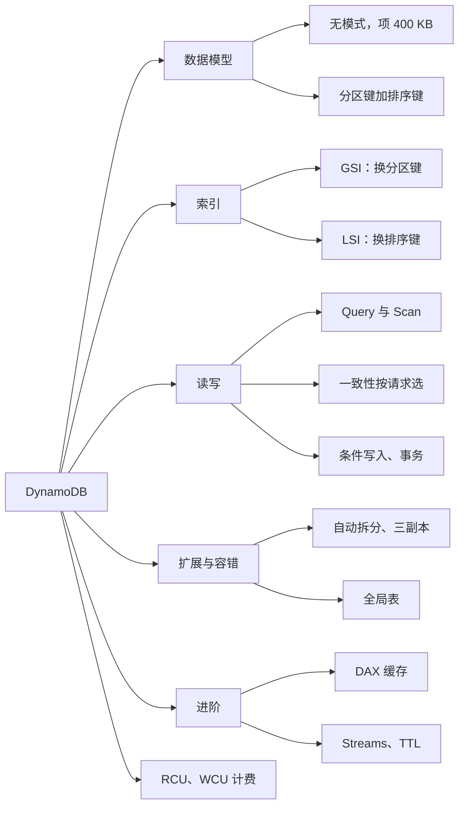

## Q
**DynamoDB · 这一章的地图**｜通览

DynamoDB 有哪几块能力？哪几个直觉决定键、索引和一致性怎么选？

## A
**一句话。** 要一个全托管、能自动扩缩、延迟稳定的键值存储，DynamoDB 用哈希分区加三副本给出，代价是查询靠键、厂商绑定 AWS。

**关键直觉。**
- **限流发生在分区，不在总量：** 单分区写入约 1000 WCU 封顶；总容量够，低基数键或单个热项照样被限流。
- **索引是为了换键，换键就有代价：** GSI 换了分区键，所以异步更新、只能最终一致；LSI 要建表时定，每个分区键值限 10 GB。大量依赖索引，说明该用关系库。
- **强的东西都翻倍收费：** 强一致读、事务成本约为普通的两倍；单项并发用条件写入就够，跨项不变量才上事务。

**容易漏的细节。**
- **投影不省容量：** 整项仍被读，按整项大小向上取整计费。
- **全局表默认最后写入胜出：** 多区域并发改同一项，会丢掉其中一个写入；条件写入只在本区域内有保证。
- **TTL 不准点，Streams 只留 24 小时：** 过期行删除前仍读得到，要自己过滤；下游落后超过一天就丢变更。
