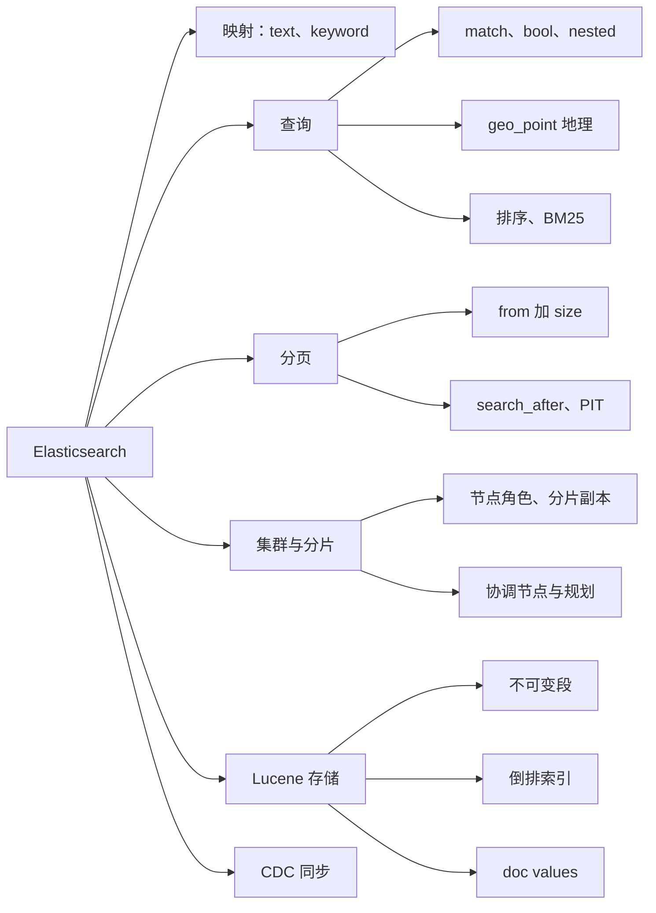

## Q
**Elasticsearch · 这一章的地图**｜通览

Elasticsearch 靠哪几块做检索？哪几个直觉决定怎么建索引、怎么挂在主库旁？

## A
**一句话。** Elasticsearch 是 Lucene 之上的分布式搜索引擎，解决数据库扛不住的排序、过滤、相关性检索；面试里多半经 CDC 挂在主库旁。

**关键直觉。**
- **检索快，是因为数据按查询方式存了几份：** 倒排索引管找文档，列式的 doc values 管排序和聚合；规划器按词频统计让最小的集合先开路。
- **不可变换来写快，代价是更新贵：** 更新等于软删加插入，点赞数这类频繁变化的字段别放进索引，计数放别处、定期刷新。
- **主分片数建索引时就定死了：** 路由是 hash 对主分片数取余，改了文档就找不到；副本只扩读吞吐，不扩写。
- **它是派生索引，不是主库：** 持久数据放别处，经 CDC 灌入；搜索只是最终一致，与源头漂移是常见 bug。

**容易漏的细节。**
- **刚写的搜不到：** 新文档要等 refresh 才可搜，默认 1 秒；批量导入常把间隔调大。
- **深翻页每个分片都要取前 from + size 条：** from/size 默认限在 1 万条；search_after 只能向前翻，要一致的快照再加 PIT。
- **nested 才能保证条件落在同一条评论上：** 拍平会匹配出评分高的 A 评论加含关键词的 B 评论；评论更新频繁就单独建索引。
