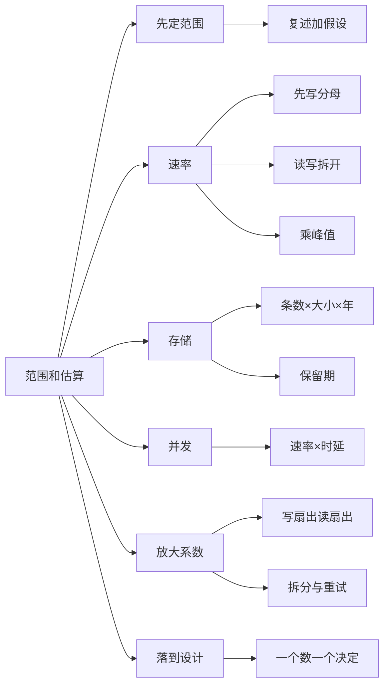

## Q
**范围和估算 · 这一章的地图**｜通览

估算要解决什么问题？先算什么、后算什么，靠哪几个直觉把数字变成设计决定？

## A
**一句话。** 估算不是报数字，是按固定顺序算出几个数，每个数换来一个设计决定；数字够选方案就停。

**关键直觉。**
- **结论由数字决定：** 同一套算法，钱包和开票算出一个主库，通知事件流算出要日志加分片；每题都说分片或都说不分，等于没算。
- **量级对就够：** 差两倍不改设计，差一个数量级才改；所以每个假设说出口，别人给别的数就改。
- **负载看放大后的数：** 一次动作变成几次读写，压在哪个组件就先设计它；再看这个数能不能等，写能排队，读用户在等。
- **旋钮比算法便宜：** 存储大先问保留期，写太高先看能不能批量，别急着分片。

**容易漏的细节。**
- **题目给了高峰就不再乘 3：** 每分钟、每小时的数先除成每秒，回算一遍。
- **热点在单个键上：** 全局读 15,000 次/秒不大，但 10% 落在最热的活动上就是 1,500 次/秒打同一个键。
- **写少也要讲主库：** 每秒一百多笔写不需要分片，但每笔都要只扣一次。
