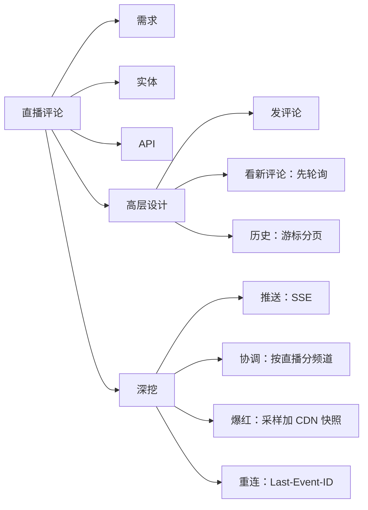

## Q
**直播评论 · 这道题的地图**｜通览

直播评论这道题按什么顺序讲？先定下哪些约束，整道题的关键直觉是什么？

## A
**一句话。** 发评论的人少、看的人极多，难点是把一条评论推给分散在许多服务器上的观众，以及某个直播爆红时需求本身要变；答案是 SSE 单向推送，分区的 pub/sub 协调服务器，超级直播改用 CDN 快照。

**先定下的约束。**
- **范围外：** 回复、点赞。
- **非功能需求：** 数百万并发直播，单个直播每秒数千条评论；可用性优先，最终一致；端到端延迟低于 200ms。
- **核心实体：** User、Live Video、Comment。
- **API：** `POST /comments/:liveVideoId`（userId 来自令牌），`GET /comments/:liveVideoId` 游标分页。

**关键直觉。**
- **连接有状态，评论要找到观众：** 同一直播的观众散在多台服务器上，朴素 pub/sub 让每台收所有评论太浪费，所以按直播分频道。
- **同机和单机容量互相冲突：** 100 万观众一台装不下，路由键加观众桶号，一个直播用一组服务器。
- **爆红直播是需求变了：** 每秒 5000 条没人读得完，先采样；CDN 快照字节反而更多，换来的是把长连接变成可缓存的无状态读。
- **评论 ID 必须按时间有序：** 游标分页和断线合并都靠它比大小。

**容易漏的细节。**
- **重连要先订阅后补拉：** 反过来，两步之间到的评论会丢。
- **慢观众会拖垮服务器：** 每连接配有界队列，满了丢旧的或断开，能补拉。
- **爆红直播的写集中在一个分区键：** 给键加后缀分散写。
