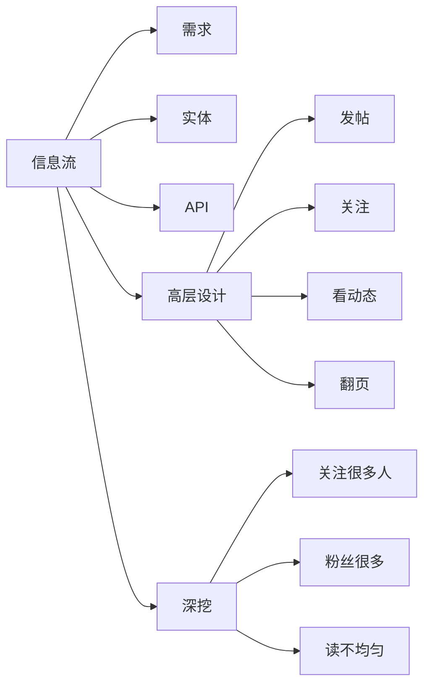

## Q
**Facebook 信息流 · 这道题的地图**｜通览

信息流这道题按什么顺序讲？先定下哪些约束，整道题的关键直觉是什么？

## A
**一句话。** 难点是扇出（fan-out）：关注很多人，读时要拼出大量请求；粉丝很多，写时要写进海量动态。答案是预计算动态，再按账号大小混合推拉。

**先定下的约束。**
- **范围外：** 点赞评论、私密帖。
- **非功能需求：** 可用性优先于一致性，发帖到可见容忍约 1 分钟；发帖和看动态都低于 500ms；20 亿用户；关注与被关注数不设限。
- **核心实体：** User、Follow、Post。
- **API：** `POST /posts`、`PUT /users/[id]/follow`、`GET /feed`（时间戳游标）。

**关键直觉。**
- **两个放大方向相反：** 关注多是读时要查很多人，粉丝多是写时要写很多份；预计算把读的开销搬到写，于是大账号成了新的难点。
- **"不设限"是题眼：** 关注数和粉丝数有上限的话，朴素方案加预计算就够；前两个深挖都来自这两个数没有上限。
- **约 1 分钟的容忍换来异步：** 发帖只要先落库，写进各人动态交给队列和 worker 慢慢做。
- **预计算只存约 200 个帖子 ID：** 没人翻一百页，翻得更深就退回朴素读法。
