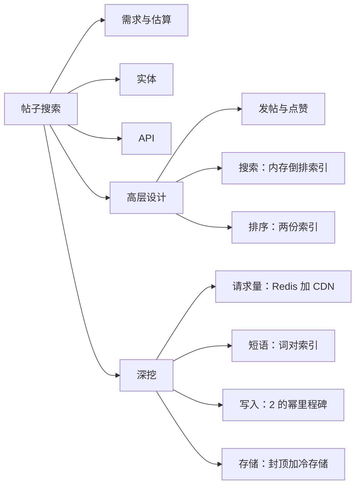

## Q
**帖子搜索 · 这道题的地图**｜通览

帖子搜索这道题按什么顺序讲？先定下哪些约束，整道题的关键直觉是什么？

## A
**一句话。** 难在每天约 10 亿帖、每秒约 10 万次点赞要写入，而且不能用搜索引擎，要按关键词快速查并按新近度或点赞数排序。答案是内存倒排索引，每词两份索引，加缓存、封顶和冷热分层。

**先定下的约束。**
- **范围外：** 模糊匹配、个性化、隐私、复杂相关性、图片；不能用现成搜索引擎。
- **非功能需求：** 中位查询低于 500ms；新帖 1 分钟内可搜；所有帖子都能找到（冷的可慢）；高可用。
- **规模：** 发帖约 1 万/秒，点赞约 10 万/秒，搜索约 1 万/秒；十年约 3.6PB。
- **核心实体：** 用户、帖子、点赞。
- **API：** 发帖、点赞两个写接口，一个搜索接口。

**关键直觉。**
- **写多读少：** 排序放在写时做，每词存两份已排好的索引；请求时排序要拉回几千万个 ID。
- **新鲜度是整条链路的预算：** 串联缓存的陈旧度相加，TTL 之和不能超过 1 分钟。
- **点赞数是长尾，优化只对头部有用：** 2 的幂里程碑让百万赞的帖子只写约 20 次；读时取前 2N 条再按新点赞数重排。
- **封顶换空间，结果不再完整：** 靠冷存储兜底。

**容易漏的细节。**
- **封顶后多词交集会漏：** 从最稀有的词出发，或给常见词对建索引。
- **按词分片热词会集中：** 搜索引擎多按帖子分片，交集在本地做，查询散发后汇总。
