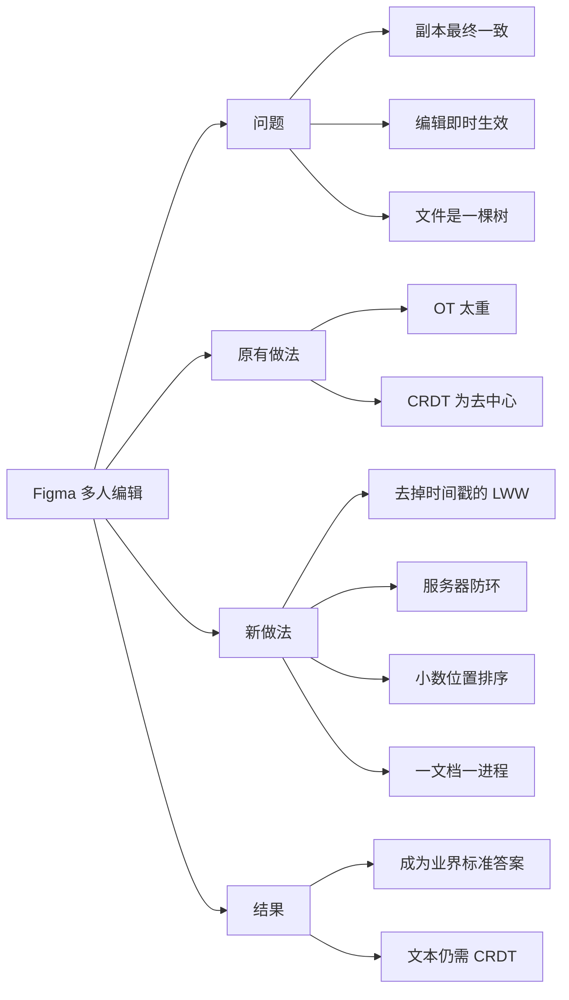

## Q
**Figma 多人编辑 · 这个案例的地图**｜通览

Figma 多人编辑的问题是什么，评估过哪些做法，最后怎么定？靠什么直觉？

## A
**一句话。** 多人同时改一棵对象树，副本要收敛、编辑要即时；Figma 让中央服务器给编辑定序，每个属性最后到达的写入胜出，服务器只防树里出现环。

**关键直觉。**
- **有中央服务器，就不用裁判算法：** CRDT 的簿记都是为了在没有裁判时判定谁最后；服务器本来就给所有编辑排序，"最后"就是最后到达服务器，时间戳和大部分簿记可砍。
- **能不能最后写入胜出，看输掉的写入丢了什么：** 整体设置一个值的编辑可以，如拖动；同一段文本里两人同时输入会让一方整段丢失，要字符级 CRDT 或 OT。
- **每个写入单独合法，合起来可能成环：** 三个并发移动各自合法，合起来成环，只有看得到全局状态的服务器能拒绝，被拒的是后到的那个。
- **客户端乐观显示：** 屏幕是已确认状态加待确认修改，收到别人的变更就变基，被拒绝的修改自然消失。

**容易漏的细节。**
- **小数位置会用完精度：** 反复在同一缝隙插入，64 位浮点数约 50 多次后两个位置相等；可改用变长字符串，或定期重新编号。
- **一文档一进程要靠租约加围栏令牌：** 旧进程停顿后可能还以为自己拥有文档，切换期间该文档暂不可编辑。
