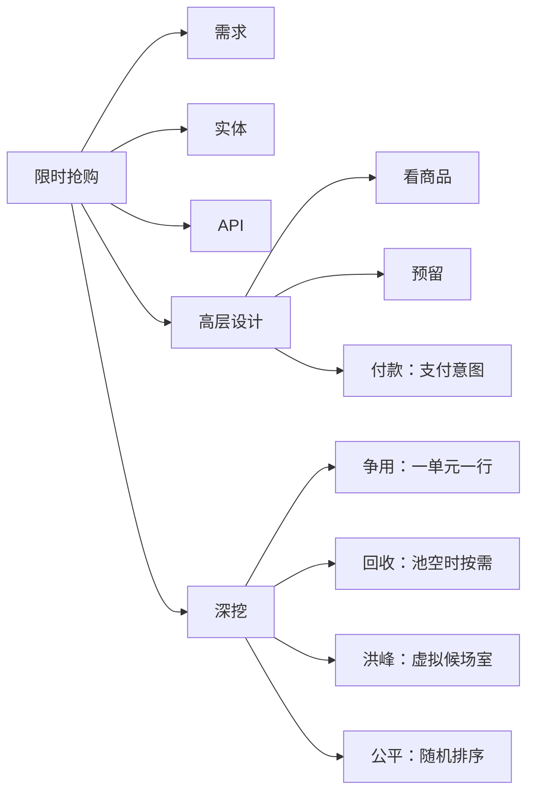

## Q
**限时抢购 · 这道题的地图**｜通览

限时抢购这道题按什么顺序讲？先定下哪些约束，整道题的关键直觉是什么？

## A
**一句话。** 难点是把极少的库存发给极多的人：既不能超卖，又要扛住争用、过期回收、入口洪峰和公平。答案是每个单元一行并行领取，加上游的虚拟候场室。

**先定下的约束。**
- **范围外：** 目录与搜索、物流退款、运营后台；隐私、容错、支付安全。
- **非功能需求：** 绝不超卖；数千万人在数秒内涌入，抢 1 万件；对有限库存公平竞争。
- **核心实体：** Product、Reservation、Purchase，另有 User。
- **API：** `GET /products/:id`、`POST /products/:id/reservations`、`POST /reservations/:id/purchases`。

**关键直觉。**
- **预留把库存和付款拆开：** 付款经第三方要几秒，不能让库存事务一直开着，所以先立刻拿走一个单元，再限时付款。
- **条件更新保证对，但串行：** 所有请求更新同一行，数据库只能一个个排；解法是把争用分散到多行，而不是加机器。
- **回收的昂贵部分只让一个人做：** 池空时持每商品的非阻塞锁批量回收，自己留一个，其余走便宜的并行路径。
- **洪峰在数据库之前削掉：** 数据库约 1 万事务/秒，候场室按它放行；公平靠随机排序，不比网速。

**容易漏的细节。**
- **付款中途预留到期：** 付款开始时把预留改成 PAYING，回收不碰它；兜底是自动退款。
- **准入令牌不防重放：** 要靠一人一预留的唯一约束。
- **一人多号抬高中签率：** 100 个号约从 0.1% 升到 9.5%。
