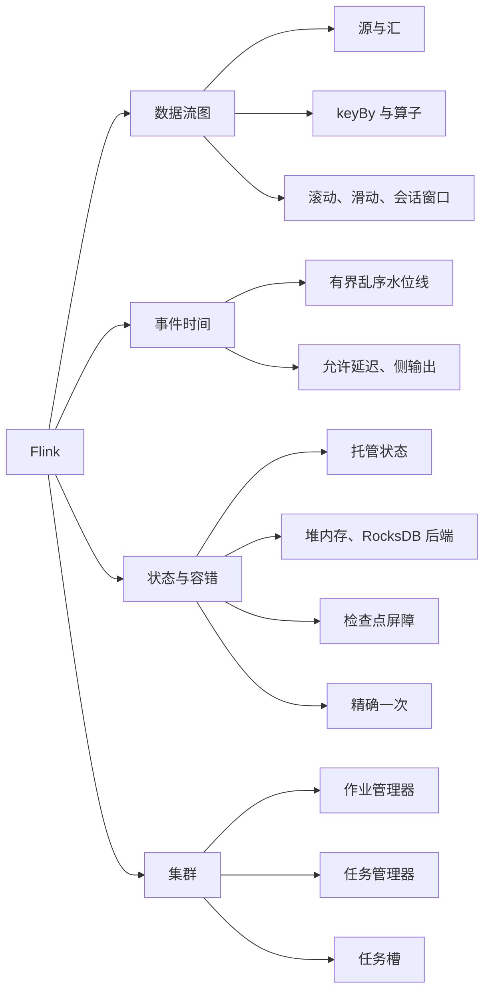

## Q
**Flink · 这一章的地图**｜通览

Flink 把有状态的实时计算拆成哪几块？哪几个直觉决定该不该用、怎么用？

## A
**一句话。** 要对无界事件流做有状态的实时计算，又要扛住崩溃、扩容、乱序，Flink 把这些做成框架：开发者描述数据流图，它管状态、检查点和恢复。

**关键直觉。**
- **有状态又要实时，才轮到 Flink：** 无状态转换用普通消费者服务，延迟宽松用批处理；框架替你扛的是状态、容错、乱序。
- **恢复是整体回退再重放：** 检查点只存状态，流本身不持久；要靠可重读的源，Kafka 保留期必须覆盖回退区间。
- **精确一次只管内部状态：** 回退重放时外部写入会重复，汇要做幂等 upsert，或用两阶段提交，后者延迟至少一个检查点间隔。
- **窗口和水位线都在拿延迟换别的：** 水位线等得越久越准、结果越晚；窗口重叠越多，状态和计算越大。

**容易漏的细节。**
- **空闲分区会拖住水位线：** 算子水位线取各输入的最小值，要开空闲检测，否则窗口一直不触发。
- **并行度别超过 Kafka 分区数：** 多出的源实例闲置；keyBy 后的热键会让一个实例成瓶颈并引起反压，检查点也跟着变慢。
- **最大并行度一开始要设得够大：** 状态按键组切分，重设并行度只是重新分配键组。
