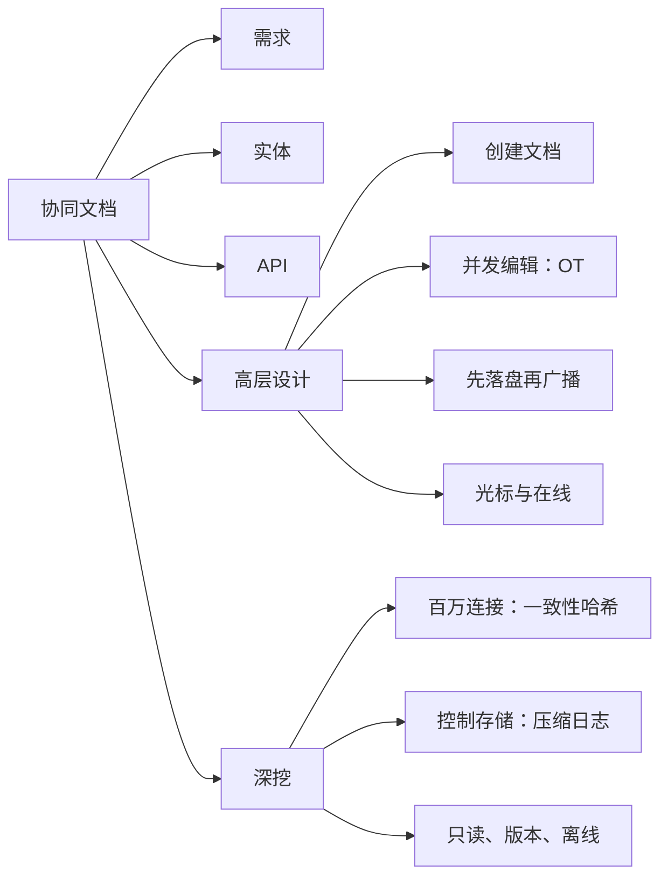

## Q
**协同文档（Google Docs） · 这道题的地图**｜通览

协同文档这道题按什么顺序讲？先定下哪些约束，整道题的关键直觉是什么？

## A
**一句话。** 核心是并发编辑怎么收敛成同一份文档：每次修改当作操作发给固定的服务器，由它用操作转换（OT）排序并持久化。后面的难点是百万 WebSocket 连接怎么摊开、操作日志怎么压缩。

**先定下的约束。**
- **范围外：** 复杂文档结构、权限、历史版本。
- **非功能需求：** 最终一致；更新延迟低于 100ms；百万并发用户、数十亿文档；单文档最多 100 个编辑者；重启后文档不丢。
- **核心实体：** 编辑者、文档、编辑、光标。
- **API：** `POST /docs`，`WS /docs/{docId}` 收发编辑与光标。

**关键直觉。**
- **单一排序者让并发变成一条有序日志：** 服务器给编辑排定全序，每个客户端只和服务器两方转换。
- **100 人上限消掉了 OT 的短板：** OT 要中心排序，只适合人少；要离线或点对点才轮到 CRDT，代价是元数据只增不减。
- **同一文档落在同一台服务器：** 排序、持久化、广播都在本机；拆开又要一个排序者，还多一跳。
- **日志是事实，内存是缓存：** 先落盘再确认广播，崩溃后重放日志，客户端重发未确认的编辑，按操作 ID 去重。

**容易漏的细节。**
- **光标位置也要随远程编辑转换：** 否则错位。
- **压缩时有人连进来：** 压缩可放弃重来，编辑不能等。
- **百万围观者要分层扇出：** 主服务器只发一份给只读层。
