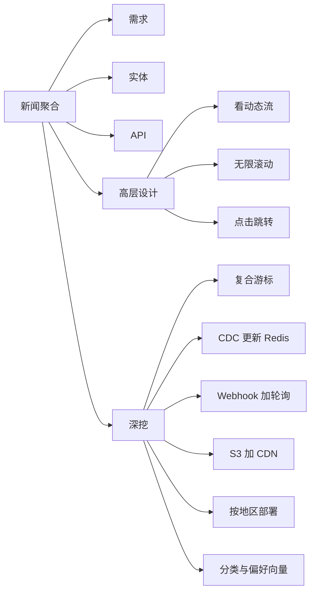

## Q
**新闻聚合（Google News） · 这道题的地图**｜通览

新闻聚合先定哪些约束？靠哪几个直觉撑住延迟和新鲜度？

## A
**一句话。** 写很少、读极多：后台收集文章，绝大多数请求读的是同一份某地区最近的文章。答案是把地区动态流预先算好放进内存缓存，用游标分页滚动，再用 CDC 让新文章秒级进缓存。

**先定下的约束。**
- **范围外：** 按兴趣定制、收藏、分享。
- **非功能需求：** 可用性优先于一致性；1 亿日活、峰值 5 亿；动态流小于 200ms；新文章 30 分钟内可见。
- **核心实体：** Article、Publisher、User。
- **API：** 只有 `GET /feed`，起步用页码，后改游标；点击直接跳出版商，无接口。

**关键直觉。**
- **读多写少，所以先把读结果算好：** 同地区的人看同一份流，只留最近 1000–2000 篇；瓶颈是读吞吐，不是容量。
- **新鲜度是各环节最坏延迟相加：** 轮询间隔 6 小时加 30 分钟 TTL，最坏约 6.5 小时；CDC 推送让缓存那一项不再叠加。
- **游标要建在唯一、只追加的键上：** 时间戳会撞，用（时间，ID）复合游标，或按入库顺序的单调 ID。
- **个性化的缓存随用户数涨：** 给每人存一份流要 TB 级；改存偏好向量，混合共享流。

**容易漏的细节。**
- **旧闻晚到的排序：** 按发布时间排，补抓的旧文章会插进用户已滚过的位置而看不到；按入库顺序排才稳。
- **内存过滤会不够一页：** 地区流 1000 篇、25 个分类均分，每类约 40 篇，只够 2 页；冷门类要补。
