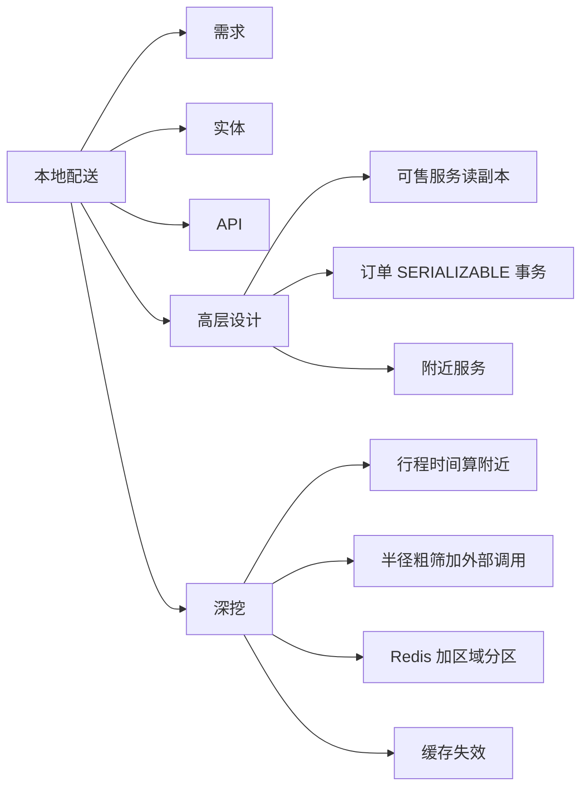

## Q
**本地配送（Gopuff） · 这道题的地图**｜通览

本地配送先定哪些约束？读写两条相反的路径靠哪几个直觉撑住？

## A
**一句话。** 读路径要聚合附近多个配送中心的库存，快且可略旧；写路径要下单不重复预订，强一致。两条需求相反的路径，拆成可售服务和订单服务。

**先定下的约束。**
- **范围外：** 支付、配送路线、搜索、取消退货。
- **非功能需求：** 可售查询小于 100ms；下单强一致；1 万个配送中心、10 万种商品；每天约 1000 万单。
- **核心实体：** Item、Inventory、DistributionCenter、Order。
- **API：** 查可售（带经纬度），下订单（也带位置）。

**关键直觉。**
- **读写需求相反，所以拆开：** 可售走读副本、可以略旧；订单写主库，库存、订单同放一个库，检查、记账、改库存才能一个事务完成。
- **单库事务换掉分布式锁：** 订单库和库存库分开加锁，崩在两步之间留下半截状态，两单交叉还会死锁。
- **「附近」要的是行程时间：** 直线距离不看路况，对全部中心调外部服务又太多；成本在外部调用，不在距离计算。

**容易漏的细节。**
- **缓存键别带精确经纬度：** 位置几乎不重复，命中率可能只有 3%；改按中心缓存。
- **SERIALIZABLE 失败要重试：** 序列化失败只是并发冲突，不等于缺货；重试时重读库存。
- **一单多件跨中心：** 优先找能一次覆盖的单个中心，找不到再拆单。
