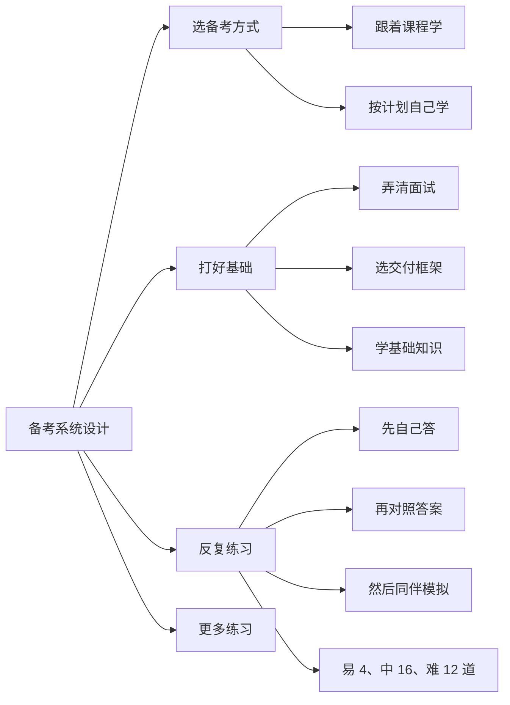

## Q
**备考系统设计 · 这一章的地图**｜通览

备考系统设计要解决什么问题？有哪几块，练习为什么要这样排？

## A
**一句话。** 先打好基础再练题：弄清面试、选定框架、学完概览，然后按难度梯度亲手练、做完才对答案。

**关键直觉。**
- **先有框架和地图，再练题：** 反过来容易陷在零散细节里，也分不清失误出在框架还是概念。
- **读懂答案不等于能产出方案：** 看着答案一切合理，面对空白白板才发现缺起手式和取舍；所以做完才看答案，否则会误以为"本来也会"。
- **说出来是另一种技能：** 时间压力下大声讲设计和阅读不同，要尽早约同伴模拟，不必等"准备好"。
- **难度梯度先建节奏：** 简单题练交付节奏，困难题在扩展、存储上要更多细节；概念已熟的人可以更快上中等题，但仍要练框架和时间分配。

**容易漏的细节。**
- **复盘看差在哪，不看得分：** 记下漏掉的需求、说不清的概念、耗时超标的步骤；说不清的概念做成卡片间隔复习。
- **模拟面试要换人：** 不同的人追问的方向不同，暴露不同的盲区。
