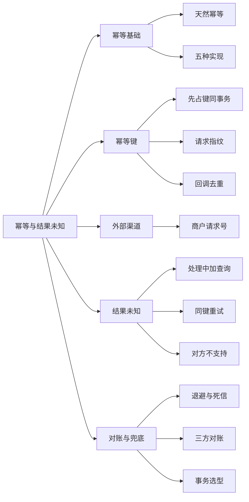

## Q
**幂等与结果未知 · 这一章的地图**｜通览

重复请求和超时怎么不重复扣款、不漏单？有哪几块，靠哪几个直觉串起来？

## A
**一句话。** 请求超时后只能重试，消息和回调也会重发，所以重复一定会来；办法是让重复无害（幂等），超时按未知处理，最后用对账兜底。

**关键直觉。**
- **键绑在逻辑操作上：** 一次扣款一个键，由发起方生成并先落库；重试换键，对方就认不出是同一笔。
- **保证来自数据库：** Redis 的 token 和锁会丢、会过期，只能挡掉大部分重复；最终防线是唯一约束或条件更新。
- **每个边界各挡一层：** 我方的键渠道看不见，调渠道要另有一个请求号；缺一层，我方重试就可能再扣一次。
- **三层依次兜底：** 查询、同键重试、对账，每层只处理上一层解决不了的；前两层出错是无声的，只有独立来源的对账能发现。

**容易漏的细节。**
- **回调先落库再应答：** 先回 success 再写库失败，渠道不再重发，钱就丢了；重复回调也要回成功，渠道才停止重试。
- **未知期间占用不释放：** 扣款超时就把库存放回去再卖，会超卖或收了钱没给货。
- **换渠道前先终结旧尝试：** 旧渠道可能已扣款，一单同一时间只留一个进行中的尝试。
