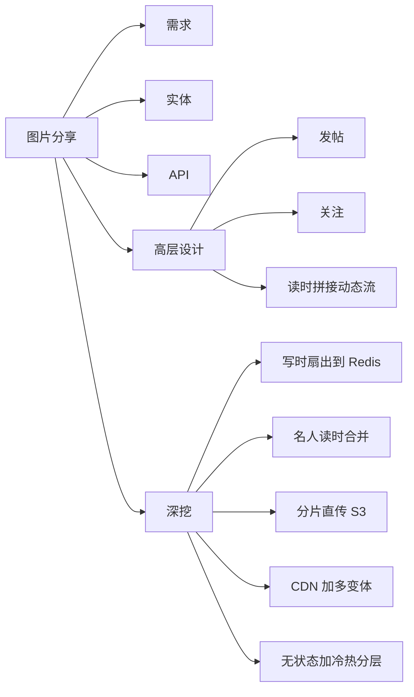

## Q
**Instagram 图片分享 · 这道题的地图**｜通览

Instagram 先定哪些约束？动态流和大媒体靠哪几个直觉撑住？

## A
**一句话。** 读远多于写，难点是动态流和大媒体；办法是把动态流提前算好存进 Redis，大文件直传对象存储再走 CDN。

**先定下的约束。**
- **范围外：** 点赞评论、搜索、快拍、直播。
- **非功能需求：** 5 亿 DAU、每天 1 亿帖；动态流小于 500ms；照片 8MB、视频 4GB 要秒开；可用性优先，动态流晚到最多约 2 分钟。
- **核心实体：** User、Post、Media、Follow。
- **API：** `POST /posts`（只交元数据）、`POST /follows`、`GET /feed`（游标）；关注者 ID 取自登录令牌。

**关键直觉。**
- **乘数是关注数：** 读时拼接，关注 1000 人就查 1000 次，峰值约 15 万次刷新每秒会放大到 1.5 亿次查询；预计算把这个乘数搬到发帖时。
- **平均写量和尾部风险要分开看：** 按平均 200 粉丝，约 23 万次 Redis 写每秒可分片扛住；一个 80 万粉丝的帖子按每秒 10 万写要 8 秒，所以名人改成读时合并。
- **流里只存不会变的 ID：** 帖子内容放另一处带短 TTL 缓存，改帖只失效一条。
- **别靠客户端报告驱动状态：** 上传完成由 S3 事件触发更新，客户端消失也不会卡在 pending。

**容易漏的细节。**
- **取关和删帖不去改流：** 读时过滤掉，所以一页可能少于 limit，要多取余量。
- **Redis 丢了要限流重建：** 大批用户同时回退读时拼接会压垮数据库，先重建最近活跃的。
- **名人阈值要加迟滞：** 粉丝数在阈值上下浮动时不来回切换。
