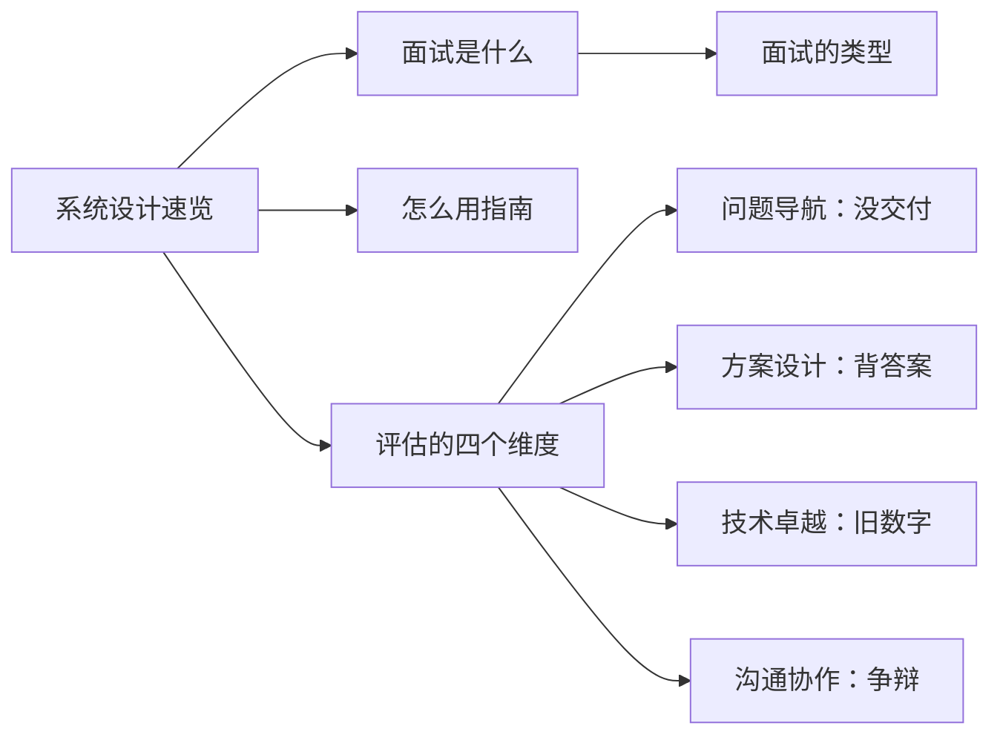

## Q
**系统设计速览 · 这一章的地图**｜通览

系统设计面试考什么、按哪四个维度评分？这些维度之间靠什么直觉串起来？

## A
**一句话。** 系统设计面试考的是把含糊的大问题拆成基础设施部件，没有唯一答案；评分落在四个维度上，各有典型的失败方式。

**关键直觉。**
- **评的是推理，不是答案：** 面试官追问理由、质疑结论、让你比较取舍，所以每个选择都要说成"因为需求 X 选 Y，代价是 Z"。
- **时间分配出错多半是问题导航的失败：** 在缓存失效上讲二十分钟、估算只展示算术，都是没先走通全部核心流程；说不出取舍则多半是方案设计。
- **级别差在谁发现问题：** 所有级别都要交出完整设计；中级常由面试官指出改进处，高级走完基础后自己列瓶颈、按影响排序，并把决定挂到需求和数字上。
- **时间紧时先学怎么走：** 顺序是交付框架、浏览关键技术、再学核心概念；只读不练，到真正要用时会卡住。

**容易漏的细节。**
- **高级还要讲运维现实：** 故障怎么发现和恢复、降级、监控、迁移回滚、成本，中级常忽略。
- **低层设计、ML 设计、前端设计要另外准备：** 多数面试是产品或基础设施设计。
