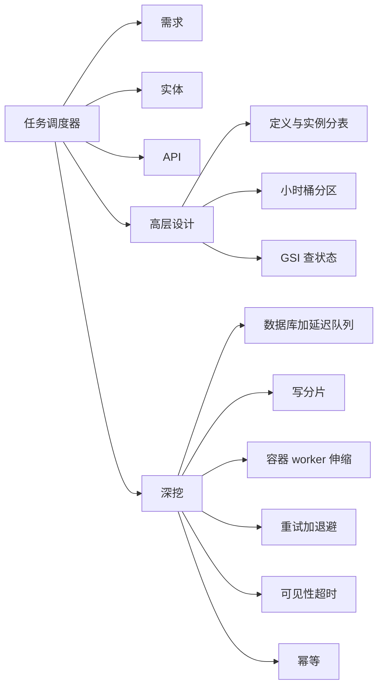

## Q
**分布式任务调度器 · 这道题的地图**｜通览

任务调度器先定哪些约束？精度、规模、可靠性靠哪几个直觉撑住？

## A
**一句话。** 数据库记得住所有任务，却查不到秒级精度；办法是分两层，数据库每隔几分钟把即将到期的任务捞出来，交给支持延迟投递的队列，由队列准点放给 worker。

**先定下的约束。**
- **范围外：** 取消和改期。
- **非功能需求：** 可用性优先；计划时间后 2 秒内开始；每秒 1 万个任务；至少执行一次。
- **核心实体：** Task、Job、Schedule、User。
- **API：** `POST /jobs`（task_id、schedule、parameters）、`GET /jobs`（按用户、状态、时间过滤）。

**关键直觉。**
- **定义和实例分开：** 周期作业只存 cron 表达式，就得逐个算才知道谁快到期；每次该跑的实例单独存一行，才查得出来。
- **轮询间隔就是精度上限：** 每 2 秒查一次，每秒 1 万个任务的 2 秒窗口约 2 万行，数据库吃不消；所以让队列负责准点，数据库只负责持久。
- **至少一次，效果靠幂等得到：** 调度器宁可重复不可漏，恰好一次的效果由任务自己幂等，或把执行 ID 带给下游去重。

**容易漏的细节。**
- **SQS 延迟最多 15 分钟：** 所以窗口取 5–10 分钟；窗口故意重叠防缝隙，用条件更新认领，重复入队也只有一个赢。
- **扫描器自己也要高可用：** 它挂了，5 分钟后的作业全部静默迟到；按分片分工，加超时报警。
- **重试要加抖动：** 同时失败的一批用同一公式会同一秒再来，把刚恢复的下游冲垮。
