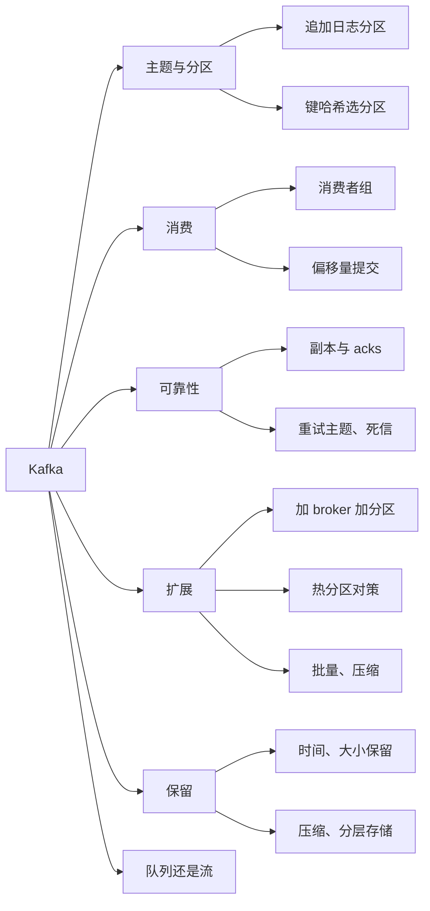

## Q
**Kafka · 这一章的地图**｜通览

Kafka 的能力怎么围着分区组织起来？哪几个直觉决定怎么用、怎么扩？

## A
**一句话。** Kafka 是分布式事件流平台：用分区追加日志把海量消息拆开并行读写，同键同分区保序，副本保证不丢。

**关键直觉。**
- **分区是并行、顺序和扩展共用的单位：** 组内消费者再多也超不过分区数；顺序只在分区内成立。所以谈扩展先讲分区键和热分区。
- **有序的范围越大，并行度越低：** 键要基数高、分布均匀；顺序无关就不设键，粘性分区器负载最均匀。
- **队列和流差在保留：** 日志不因被消费而删除，所以多个消费者组能独立读、能重放；重试和死信要自己搭，需要内置就选 SQS。

**容易漏的细节。**
- **提交时机定了丢还是重：** 先提交后处理，崩溃会丢；先处理后提交，崩溃会重复，所以处理要幂等。
- **加分区会改键到分区的映射：** 同键的新旧消息从此分在两个分区，分区数要提前预留。
- **估容量先比吞吐和存储：** 5 万条每秒、每条 1 KB、保留 7 天、三副本约 90 TB，瓶颈是存储不是吞吐。
