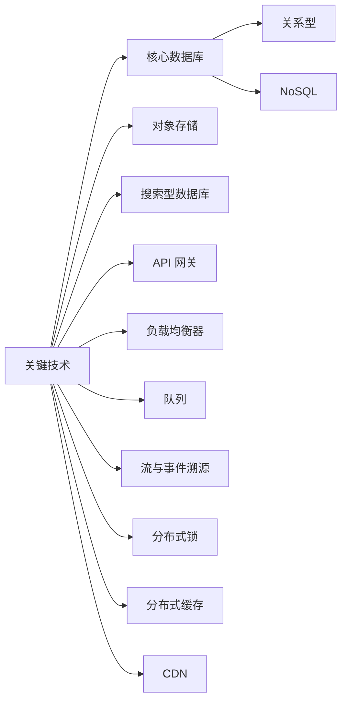

## Q
**关键技术 · 这一章的地图**｜通览

关键技术要解决什么问题？有哪些积木，选型和讲解靠哪几个直觉？

## A
**一句话。** 设计就是组装积木；每一类至少熟悉一个产品，覆盖约 90% 的题目，先广后深，用具体特性而不是笼统对比来讲选择。

**关键直觉。**
- **讲特性，不比品类：** "要扩展所以用 NoSQL"是红旗，关系库加分片和读副本也能扩展；应说"选 Postgres，因为事务让订单和库存一起成败"。
- **队列和流差在消息会不会留下：** 队列消费完就没了，适合把活分给一池 worker；要多个独立消费者或回放历史，用流。
- **队列只对能异步的环节有用：** 它会增加等待，放在 300 ms 的同步路径上几乎必然破坏目标；进得比出得快时，积压清不完，要靠反压拒绝或降速。
- **大块数据绕开应用服务器：** 文件放对象存储，库里只存元数据和 URL，上传下载用预签名 URL 直连，字节不经应用服务器，也省下十倍左右的存储单价。

**容易漏的细节。**
- **带过期的锁仍可能两人同时写：** 持有者停顿超时后锁易主，旧持有者醒来继续写；要靠被保护资源上校验递增的围栏令牌。
- **搜索索引不要双写：** 用变更数据捕获或发件箱经队列更新，可重放；写入后约 1 秒才可见是预期行为。
- **队列多为至少一次投递：** 消费者必须幂等，反复失败的消息进死信队列。
