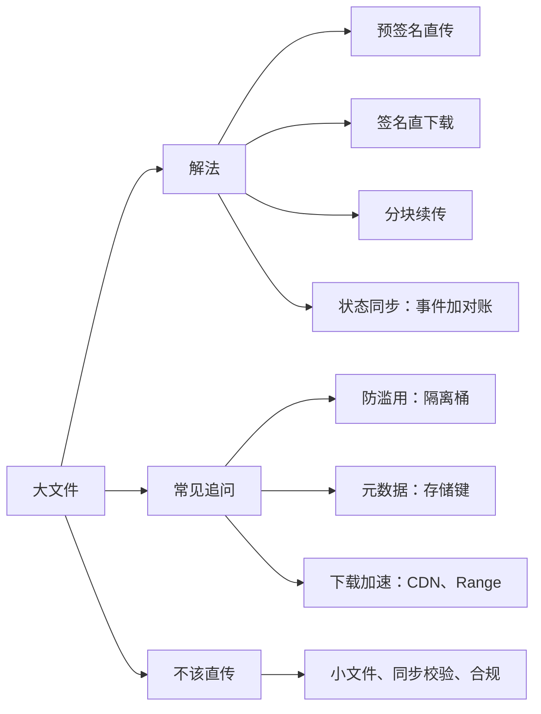

## Q
**大文件 · 这一章的地图**｜通览

大文件这一章要解决什么问题？有哪几块，靠哪几个直觉串起来？

## A
**一句话。** 大文件的字节不该经过应用服务器。服务器只发临时凭证，客户端直连对象存储，再补上续传和状态同步。

**关键直觉。**
- **服务器从搬运工变成门卫：** 授权验证一次，之后客户端直接和存储交互；代价是失去了对字节的观察，进度、完成与否都得另想办法。
- **直传把难题挪到了状态上：** 数据库说 pending，存储里可能已有完整文件，也可能没有；所以不能信客户端喊"传完了"，要以存储事件为主、对账兜底。
- **凭证本身就是安全边界：** 谁拿到 URL 谁就能用，大小、类型、有效期都得签进去；存储键由服务器生成，不让客户端自己起。
- **模式有适用边界：** 约 10MB 以下、要在接受前就校验、必须存储前扫描的场景，该走服务器就走服务器。

**容易漏的细节。**
- **存储事件至少一次且不保证顺序：** 处理程序要用"pending 改成 completed"这类条件更新，重复执行才无害。
- **未完成的分段上传一直收费：** 没有自动过期，要靠生命周期规则或主动中止清理。
- **预签名 URL 无法单独吊销：** 发出后只能等过期；用临时凭证签名时，有效期还会被凭证的过期时间截短。
