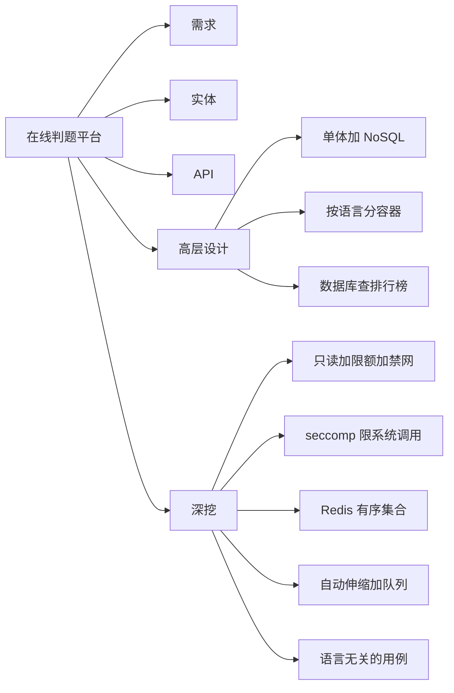

## Q
**在线判题平台 · 这道题的地图**｜通览

判题平台先定哪些约束？安全、算力和排行榜靠哪几个直觉撑住？

## A
**一句话。** 难点不在流量，而在安全地运行不可信代码、比赛瞬间的算力，以及排行榜别压垮数据库；答案是单体加容器沙箱，再配队列和 Redis 有序集合。

**先定下的约束。**
- **范围外：** 登录认证、用户资料、支付、分析、社交。
- **非功能需求：** 可用性优先；运行用户代码要隔离；提交后 5 秒内出结果；支持 10 万人的比赛。
- **核心实体：** Problem、Submission、Leaderboard。
- **API：** 题目列表、单题、`POST /problems/:id/submit`、排行榜；userId 取自会话，时间戳由服务端生成。

**关键直觉。**
- **体量小，难处在别处：** 几十万用户、约 4000 道题，单体就够；复杂度花在隔离和瞬时算力上。
- **容器共享宿主内核：** 所以只是起点，要叠只读、限额、超时、禁网、seccomp；防恶意用户可换 gVisor 或微虚拟机。
- **算力看用例耗时：** 1 万个并发提交、每个约 100 个用例、每例 100ms，1 分钟跑完约需 1667 核；每例 30ms 约 500 核。先量再定容量。
- **排行榜读不碰库：** 提交时同时写库和 Redis 有序集合，客户端 5 秒轮询；晚几秒可接受，不用 WebSocket。

**容易漏的细节。**
- **每次判题要干净环境：** 用预热容器池，跑完即销毁。
- **队列至少一次投递：** 结果按提交 ID 幂等写；可见性超时要大于最坏判题时间；反复崩的提交进死信队列。
- **排行榜的时间口径：** 取每题首次通过的时间，再取其中最晚的。
