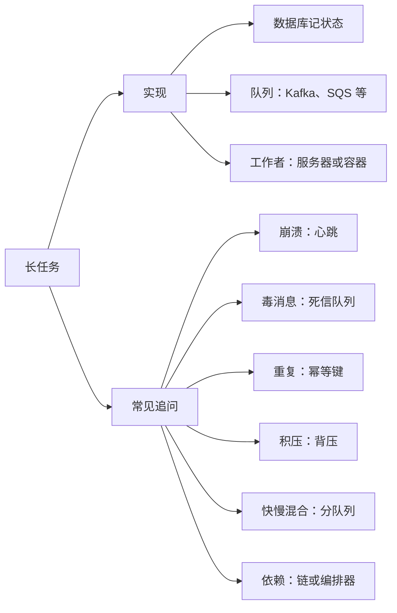

## Q
**长任务 · 这一章的地图**｜通览

长任务这一章要解决什么问题？有哪几块，靠哪几个直觉串起来？

## A
**一句话。** 几十秒的活同步做会超时、体验差。把请求拆成两段：立刻入队并返回任务 ID，后台工作者慢慢处理。

**关键直觉。**
- **异步是拿简单换扩展：** 换来响应快、前后端独立扩缩、故障隔离，付出最终一致、状态追踪和一整套新的失败模式。
- **任务会被执行不止一次：** 崩溃重派、重复提交、心跳误判都会让同一个任务再跑一遍，所以工作本身必须幂等。
- **数据库是权威，队列只是触发信号：** 消息里只放任务 ID，队列挂了请求照收，任务在库里堆成 pending。
- **没有特殊理由就选熟悉的队列：** 要展示的是职责分离；快操作（不到 100ms）不值得异步。

**容易漏的细节。**
- **入库和入队不在同一个事务：** 库里有 pending 而队列里没有，任务永远没人处理；用清扫器重新入队，或事务性发件箱。
- **心跳间隔两头都有代价：** 太短，GC 停顿就被误判成失败；太长，崩溃后要等很久才重派。
- **重试要退避加抖动：** 下游过载时立刻重试只会加重；只重试瞬时错误，永久错误直接失败。
- **机器会被随时回收：** 收到 SIGTERM 后停止拉新任务，做不完就放弃确认，进度写检查点。
